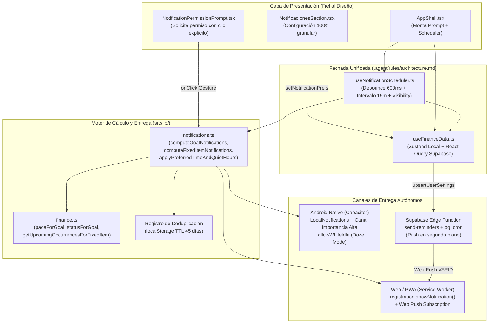

# Plan de Acción Arquitectónico: Sistema Integral de Notificaciones Inteligentes, Personalizables y Autónomas (Web/PWA, Android y Nube)

> **Rol del Documento:** Especificación Arquitectónica, Guía de Implementación y Checklist de Progreso con Checkpoints de Git (`.agent/contract.md`).  
> **Estado:** ✅ COMPLETADO (5/5 Fases y Checkpoints ejecutados y verificados).  
> **Reglas de Oro (`.agent/rules/architecture.md`, `.agent/contract.md`, `.agent/security_audit.md` & `.agentignore`):**
> 1. Todas las vistas (`src/pages/**`) y componentes (`src/components/**`) consumen **exclusivamente** la fachada `useFinanceData`. Queda prohibido importar `useFinance`, React Query o `supabase` directamente en vistas o componentes visuales.
> 2. Nunca mezclar lógica de red en slices de Zustand ni estado global en `src/services/**`.
> 3. Cero errores de TypeScript (`npx tsc --noEmit` con código `0`) y todas las suites de pruebas en verde (`npm test` 100% pass) antes de cada commit.
> 4. Respetar `.agentignore` (prohibido tocar `node_modules/`, `dist/`, `.env*`).
> 5. Respetar `.agent/contract.md`: este documento define la arquitectura, contratos, imports exactos, firmas y estructura (`// TODO: Implementar lógica core`) sin escribir la implementación final en el código fuente hasta iniciar la fase de construcción.
> 6. **Estrategia de Checkpoints ("Pequeñas Victorias"):** Cada sub-etapa verificada culmina en un **🏁 CHECKPOINT (Commit Atómico)**. Si algo falla posteriormente, el historial de Git permite identificar exactamente qué cambio rompió qué contrato, cuándo ocurrió y por qué, facilitando un `git revert` o `git bisect` limpio.

---

## 1. Diagnóstico de Causa Raíz (¿Por qué no funcionan las notificaciones hoy?)

### 1.1. Solicitud de permisos bloqueada por los navegadores y estado mal mapeado
- **Evidencia:**
  - En `src/components/app/AppShell.tsx` (L79-L85), `requestNotificationPermissions()` se invoca dentro de un `useEffect` automático al montar la aplicación (sin gesto del usuario). Los navegadores modernos (Chrome, Safari iOS/macOS, Edge, Firefox) bloquean o ignoran silenciosamente `Notification.requestPermission()` cuando no proviene de un evento directo de clic (`onClick`).
  - En `src/hooks/useSessionManager.ts` (L128), se vuelve a llamar `await requestNotificationPermissions()` dentro de un callback de WebSocket (`postgres_changes`), también sin gesto de usuario.
  - En `src/lib/notifications.ts` (L82), `Notification.requestPermission()` devuelve `"granted" | "denied" | "default"`, pero el código hace `result === "granted" ? "granted" : "denied"`, convirtiendo `"default"` (pendiente/cerrado) en `"denied"`.
  - En `src/pages/ajustes/secciones/NotificacionesSection.tsx` (L25-L33), el estado `permissionGranted` solo lee `prefs.enabled`, engañando al usuario al mostrar un badge verde **"Activo"** aunque el permiso real del navegador o de Android esté en `"prompt"` o `"denied"`.

### 1.2. Destrucción total de la cola durante el Horario Silencioso (`quietHours`)
- **Evidencia:**
  - En `src/lib/notifications.ts` (L46-L63, L316, L388, L446), `isQuietHours(prefs)` evalúa si la hora **actual** (`new Date()`) está entre `22:00` y `08:00`.
  - `scheduleAllNotifications()` (L443) primero ejecuta `cancelAllNotifications()` (borrando todas las alarmas programadas en Web y Android) y acto seguido, si el usuario abrió la app a las `22:15`, `computeGoalNotifications` y `computeFixedItemNotifications` retornan `[]`.
  - **Consecuencia:** Abrir la app de noche destruye todas las notificaciones futuras y deja la cola vacía. Además, si una alerta de hoy debía sonar a las `09:00` y el usuario abre la app a las `22:30`, ni se dispara ni se pospone a las `08:00` del día siguiente.

### 1.3. Descarte de notificaciones del mismo día (`delay <= 0`) y fallo de `new Notification()` en PWA móvil
- **Evidencia:**
  - En `src/lib/notifications.ts` (L179-L198 y L264): todas las alertas se calculan con fecha a las `10:00:00` (o `09:00:00`). Si el usuario abre la app a las `10:05 AM`, `delay = scheduledAt.getTime() - Date.now()` es negativo (`delay <= 0`) y `scheduleWebNotification` la descarta sin mostrarla.
  - Cuando `delay > 0`, usa `new Notification(title, { body })` dentro de un `setTimeout` en memoria (que muere al cerrar la pestaña) y en Chrome Android / Safari iOS PWA lanza `TypeError: Failed to construct 'Notification': Illegal constructor` porque los navegadores móviles exigen `ServiceWorkerRegistration.showNotification()`.

### 1.4. Fallos críticos en Android Nativo (Capacitor)
- **Evidencia:**
  - `capacitor.config.ts` (L12) configura `smallIcon: "ic_stat_icon_config_sample"` y `src/lib/notifications.ts` (L156) pasa `smallIcon: "ic_notification"`. Ninguno de esos dos recursos existe en `android/app/src/main/res/drawable/`. En Android 8+ un recurso `smallIcon` inválido hace que `NotificationManager` aborte la notificación silenciosamente.
  - No se invoca `LocalNotifications.createChannel(...)` ni se pasa `channelId: "finance_pal_reminders"`.
  - En `LocalNotifications.schedule` (L154) no se incluye `schedule: { at: ..., allowWhileIdle: true }`, por lo que Android Doze Mode bloquea las alarmas con pantalla apagada.
  - `AndroidManifest.xml` carece de `RECEIVE_BOOT_COMPLETED`, `VIBRATE` y `SCHEDULE_EXACT_ALARM`.
  - `Math.abs(hashCode(id))` puede devolver `2147483648` cuando `hash === -2147483648`, desbordando el entero con signo de 32 bits en Java.

### 1.5. Fórmula matemática rota para "Meta atrasada según el plan"
- **Evidencia:**
  - En `src/lib/notifications.ts` (L305-L307):
    ```ts
    const daysElapsed = Math.max(1, Math.ceil((now.getTime() - parseDateLocal(goal.deadline).getTime()) / (1000 * 60 * 60 * 24)) + 30);
    const expectedProgress = (goal.target / Math.max(1, daysElapsed)) * daysElapsed;
    ```
    Matemáticamente `(A / B) * B` **siempre es igual a `goal.target`**. Jamás calcula el progreso lineal entre `goal.createdAt` y `goal.deadline` que sí implementa `src/pages/metas/types.ts` (`expectedAt`, `actualAt`, `statusFor`, `paceFor`).

### 1.6. Soporte incompleto de Gastos/Ingresos Recurrentes y colisión con el auto-registro
- **Evidencia:**
  - `src/lib/notifications.ts` (L382-L436) y `supabase/functions/send-reminders/index.ts` (L149-L180) solo calculan `monthly` y `weekly`, ignorando 7 frecuencias del modelo (`biweekly`, `bimonthly`, `quarterly`, `fourmonthly`, `biannual`, `yearly`, `one_time`).
  - `computeFixedItemNotifications` programa la notificación en `nextDueDate` en lugar de `nextDueDate - daysBefore`, por lo que las alertas anticipadas (ej. 3 días antes) jamás se disparan en la fecha previa.
  - No permite elegir cuántos días antes avisar para recurrentes (`fixedUpcomingDays`), ni filtrar por tipo (Gastos vs Ingresos vs Ahorros), ni evita duplicar avisos cuando `reconcileScheduledTransactions` auto-registra el movimiento el mismo día de pago.

### 1.7. Desconexión Reactiva, Hidratación Zustand v5 y Brechas de Seguridad en Supabase
- **Evidencia:**
  - `scheduleAllNotifications` solo se ejecuta una vez al montar `AppShell.tsx` (cuando las queries de Supabase aún están cargando) y en `NotificacionesSection.tsx` (que además viola la arquitectura importando `useFinance` directamente en lugar de `useFinanceData`).
  - En `src/store/finance-store.ts` (L99-L114), `appSettings` está re-declarado pisando `settings-slice.ts`, y `persist` carece de función `merge` profunda: los usuarios existentes en `version: 5` tendrían `prefs.fixedUpcomingDays === undefined`, causando `TypeError` al hidratar.
  - `user_settings` en Supabase no persiste `notification_prefs`, por lo que `supabase/functions/send-reminders/index.ts` ignora la configuración del usuario.
  - Problemas de seguridad detectados en `.agent/security_audit.md`: `SEC-003` (`send-reminders` rechaza el `SUPABASE_SERVICE_ROLE_KEY` enviado por `pg_cron`), `SEC-005` (`web-push.ts` borra por `endpoint` sin filtrar `.eq("user_id", session.user.id)`) y `SEC-017` (`CORS` abierto con `*` y sin `x-function-secret` en `Access-Control-Allow-Headers`).

---

## 2. Estructura de Archivos a Crear / Modificar

```text
android/app/src/main/AndroidManifest.xml                     # [MODIFICAR] Añadir permisos RECEIVE_BOOT_COMPLETED, VIBRATE y SCHEDULE_EXACT_ALARM
android/app/src/main/res/drawable/ic_stat_notification.xml   # [CREAR] Ícono vectorial monocromático 24dp para barra de estado Android
capacitor.config.ts                                          # [MODIFICAR] Configurar smallIcon: "ic_stat_notification"
public/sw.js                                                 # [MODIFICAR] Soportar tag, silent/vibrate, SHOW_LOCAL_NOTIFICATION y navegación click
supabase/schema_push_notifications.sql                       # [MODIFICAR] Idempotencia DROP POLICY IF EXISTS y columna notification_prefs jsonb DEFAULT NULL
supabase/functions/send-reminders/index.ts                   # [MODIFICAR] Auth cron/secret (SEC-003), CORS (SEC-017), prefs usuario, 9 frecuencias y ritmo de metas
src/lib/finance.ts                                           # [MODIFICAR] NotificationPreferences 100% configurable, paceForGoal, statusForGoal, getUpcomingOccurrencesForFixedItem
src/lib/validators.ts                                        # [MODIFICAR] Añadir notificationPreferencesSchema y registrar en validationSchemas
src/lib/sanitizers.ts                                        # [MODIFICAR] Añadir sanitizeNotificationPrefs con fusión segura de defaults
src/lib/schema-migrations.ts                                 # [MODIFICAR] Sanitizar appSettings.notifications en sanitizeMigratedData
src/store/slices/settings-slice.ts                           # [MODIFICAR] Sanitizar en setNotificationPrefs
src/store/finance-store.ts                                   # [MODIFICAR] Eliminar duplicados de appSettings y añadir merge profundo en persist()
src/lib/web-push.ts                                          # [MODIFICAR] Filtrar por user_id al borrar (SEC-005) y exportar isWebPushSubscribed
src/lib/notifications.ts                                     # [MODIFICAR] Re-exportar tipos/defaults, SW Web, canal Android/Doze, deduplicación y cálculo
src/pages/metas/types.ts                                     # [MODIFICAR] Re-exportar paceFor, expectedAt, actualAt, statusFor desde @/lib/finance
src/services/settings.service.ts                             # [MODIFICAR] Sincronizar notification_prefs con fallback resiliente si falta columna SQL
src/services/cloudSync.service.ts                            # [MODIFICAR] Incluir notificationPrefs en CloudSettings y CloudSyncInput
src/hooks/mutations/useCloudSyncMutations.ts                 # [MODIFICAR] Sincronizar notificationPrefs al subir/descargar settings
src/hooks/useSessionManager.ts                               # [MODIFICAR] Quitar requestNotificationPermissions() sin gesto en evento new_login
src/hooks/useFinanceData.ts                                  # [MODIFICAR] Exponer setNotificationPrefs/setAccessibilitySettings y sincronizar con user_settings
src/hooks/useNotificationScheduler.ts                        # [CREAR] Hook reactivo autónomo (evalúa al iniciar, al cambiar datos, en focus y cada 15 min)
src/components/app/NotificationPermissionPrompt.tsx          # [CREAR] Banner personalizado fiel al diseño para solicitar permisos con User Gesture
src/components/app/AppShell.tsx                              # [MODIFICAR] Migrar a useFinanceData, montar useNotificationScheduler y NotificationPermissionPrompt
src/pages/ajustes/AjustesHub.tsx                             # [MODIFICAR] Migrar de useFinance a useFinanceData
src/pages/ajustes/secciones/NotificacionesSection.tsx        # [MODIFICAR] Panel 100% configurable fiel al diseño usando exclusivamente useFinanceData
src/test/notifications.test.ts                               # [CREAR] Suite de pruebas unitarias para notificaciones, metas, 9 frecuencias y horario silencioso
```

*(No se requieren paquetes npm adicionales; se utilizan las dependencias ya instaladas en `package.json`).*

---

## 3. Arquitectura y Flujo del Sistema



---

## 4. Especificación Técnica Detallada por Fase

### FASE 1: Modelo de Preferencias 100% Configurable, Fórmulas de Metas/Recurrentes e Hidratación Segura

#### 1.1. `src/lib/finance.ts`
- **Tipos e Interfaces a definir y exportar:**
  ```ts
  export type NotificationRepeatFrequency = "daily" | "every_3_days" | "weekly" | "once";
  export type NotificationPermissionState = "granted" | "denied" | "prompt" | "unsupported";

  export interface NotificationPreferences {
    enabled: boolean;
    pushEnabled: boolean;
    localEnabled: boolean;
    inAppToastEnabled: boolean;
    // Alertas de Metas (límites de fecha y atraso según el plan)
    goalDeadlineReminders: boolean;
    upcomingDays: number[];                    // ej. [7, 3, 1, 0] (0 = mismo día del vencimiento)
    overdueAlert: boolean;
    overdueRepeat: NotificationRepeatFrequency;
    behindPaceAlert: boolean;
    behindPaceRepeat: NotificationRepeatFrequency;
    behindPaceTolerancePct: number;            // porcentaje del objetivo (2, 5, 10)
    // Alertas de Conceptos Fijos / Recurrentes (gastos, ingresos, ahorros)
    fixedItemReminders: boolean;
    notifyFixedExpenses: boolean;
    notifyFixedIncomes: boolean;
    notifyFixedSavings: boolean;
    fixedUpcomingDays: number[];               // ej. [3, 1, 0] (días antes + día de cobro)
    skipIfAlreadyRecorded: boolean;
    // Horario, canal y privacidad
    preferredTime: string;                     // "HH:mm" (ej. "09:00")
    quietHoursEnabled: boolean;
    quietHours: { start: string; end: string }; // ej. { start: "22:00", end: "08:00" }
    soundEnabled: boolean;
    vibrationEnabled: boolean;
    hideAmountsInNotifications: boolean;
  }

  export const DEFAULT_NOTIFICATION_PREFS: NotificationPreferences = {
    enabled: true,
    pushEnabled: true,
    localEnabled: true,
    inAppToastEnabled: true,
    goalDeadlineReminders: true,
    upcomingDays: [7, 3, 1, 0],
    overdueAlert: true,
    overdueRepeat: "every_3_days",
    behindPaceAlert: true,
    behindPaceRepeat: "weekly",
    behindPaceTolerancePct: 2,
    fixedItemReminders: true,
    notifyFixedExpenses: true,
    notifyFixedIncomes: true,
    notifyFixedSavings: true,
    fixedUpcomingDays: [3, 1, 0],
    skipIfAlreadyRecorded: true,
    preferredTime: "09:00",
    quietHoursEnabled: true,
    quietHours: { start: "22:00", end: "08:00" },
    soundEnabled: true,
    vibrationEnabled: true,
    hideAmountsInNotifications: false,
  };

  export interface GoalPaceInfo {
    remaining: number;
    days: number;
    perDay: number;
    perWeek: number;
    perMonth: number;
    overdue: boolean;
  }

  export interface GoalStatusInfo {
    kind: "done" | "behind" | "ahead" | "ontrack";
    diff: number;
    ideal: number;
    actual: number;
  }

  export interface FixedOccurrenceInfo {
    dueDate: Date;
    dueISO: string;
    daysUntil: number;
    alreadyRecorded: boolean;
    autoRecordedToday: boolean;
  }
  ```
- **Firmas de funciones puras a añadir en `src/lib/finance.ts`:**
  ```ts
  export function paceForGoal(goal: Goal, now?: Date): GoalPaceInfo | null {
    // TODO: Implementar lógica core (calcular remaining, días hasta deadline, cuota diaria/semanal/mensual y flag overdue)
  }

  export function expectedGoalAt(goal: Goal, date: Date): number {
    // TODO: Implementar lógica core (interpolación lineal entre startOfDay(goal.createdAt) y startOfDay(goal.deadline))
  }

  export function actualGoalAt(goal: Goal, date: Date): number {
    // TODO: Implementar lógica core (sumar history hasta date o usar goal.current si no hay historial detallado)
  }

  export function statusForGoal(
    goal: Goal,
    tolerancePct?: number,
    now?: Date,
  ): GoalStatusInfo | null {
    // TODO: Implementar lógica core:
    // 1. Si goal.current >= goal.target retornar kind: "done".
    // 2. Si no tiene deadline retornar null.
    // 3. Calcular ideal = expectedGoalAt(goal, today), actual = actualGoalAt(goal, today), diff = actual - ideal.
    // 4. Usar tolerance = Math.max(50, goal.target * ((tolerancePct ?? 2) / 100)).
    // 5. Retornar "behind" si diff < -tolerance, "ahead" si diff > tolerance, o "ontrack".
  }

  export function getUpcomingOccurrencesForFixedItem(
    item: FixedItem,
    transactions?: Transaction[],
    now?: Date,
    maxCount?: number,
  ): FixedOccurrenceInfo[] {
    // TODO: Implementar lógica core:
    // 1. Validar item.active y que no haya expirado (endDate >= today).
    // 2. Soportar las 9 frecuencias ("weekly", "biweekly", "monthly", "bimonthly", "quarterly",
    //    "fourmonthly", "biannual", "yearly", "one_time") respetando fin de mes (Math.min(payDay, daysInMonth)).
    // 3. Retornar hasta maxCount (default 2: ciclo actual y siguiente) ocurrencias >= startOfDay(now).
    // 4. Marcar alreadyRecorded verificando buildScheduledTxId(item.id, dueISO) o tx.fixedId === item.id en dueISO,
    //    y autoRecordedToday cuando dueISO === todayISO y el ID coincide con buildScheduledTxId.
  }
  ```

#### 1.2. `src/pages/metas/types.ts`
- **Imports y Re-exports exactos:**
  ```ts
  import {
    Goal,
    paceForGoal,
    expectedGoalAt,
    actualGoalAt,
    statusForGoal,
  } from "@/lib/finance";

  export const paceFor = paceForGoal;
  export const expectedAt = expectedGoalAt;
  export const actualAt = actualGoalAt;
  export const statusFor = (g: Goal): ReturnType<typeof statusForGoal> => statusForGoal(g, 2);
  ```
  *(Elimina la duplicación de código entre la vista de Metas y el motor de notificaciones).*

#### 1.3. `src/lib/validators.ts` y `src/lib/sanitizers.ts`
- En `src/lib/validators.ts`:
  - Definir `notificationRepeatFrequencySchema = z.enum(['daily', 'every_3_days', 'weekly', 'once'])`.
  - Definir `notificationPreferencesSchema` validando rangos de días (`0..60`), horas en formato `^([01]\d|2[0-3]):([0-5]\d)$` y booleanos.
  - Registrar `notificationPreferences: notificationPreferencesSchema` en `validationSchemas`.
- En `src/lib/sanitizers.ts`:
  - Importar `NotificationPreferences, DEFAULT_NOTIFICATION_PREFS, NotificationRepeatFrequency` desde `./finance`.
  - Exportar `sanitizeNotificationPrefs(raw: unknown): NotificationPreferences`:
    ```ts
    export function sanitizeNotificationPrefs(raw: unknown): NotificationPreferences {
      // TODO: Implementar lógica core:
      // Fusionar de forma segura cualquier objeto parcial/antiguo con DEFAULT_NOTIFICATION_PREFS,
      // deduplicar y ordenar descendentemente upcomingDays y fixedUpcomingDays (números enteros 0..60),
      // validar formato HH:mm en preferredTime y quietHours, y limitar behindPaceTolerancePct a [1..50].
    }
    ```

#### 1.4. `src/lib/schema-migrations.ts`, `src/store/slices/settings-slice.ts` y `src/store/finance-store.ts`
- En `src/lib/schema-migrations.ts`:
  - Importar `sanitizeNotificationPrefs` desde `./sanitizers` y aplicarlo en `sanitizeMigratedData` para que `appSettings.notifications` siempre tenga todos los campos nuevos.
- En `src/store/slices/settings-slice.ts`:
  - En `setNotificationPrefs`, fusionar con el estado actual y pasar el resultado por `sanitizeNotificationPrefs`.
- En `src/store/finance-store.ts`:
  - Eliminar las propiedades duplicadas `appSettings`, `setNotificationPrefs` y `setAccessibilitySettings` en L99-L114 que sobrescribían `createSettingsSlice`.
  - Añadir la opción `merge` en `persist(...)` para que incluso cuando `version === 5` ya coincida en `localStorage`, `appSettings.notifications` se hidrate mediante `sanitizeNotificationPrefs`.

---

### FASE 2: Motor Multiplataforma Autónomo (Android Nativo + Service Worker Web + Deduplicación)

#### 2.1. Configuración Android (`ic_stat_notification.xml`, `capacitor.config.ts`, `AndroidManifest.xml`)
- **`android/app/src/main/res/drawable/ic_stat_notification.xml` [CREAR]:**
  - Vector drawable Android (`24dp x 24dp`, `#FFFFFF`) con ícono financiero limpio para la barra de estado.
- **`capacitor.config.ts` [MODIFICAR]:**
  - Actualizar `plugins.LocalNotifications.smallIcon` a `'ic_stat_notification'` e `iconColor: '#3B82F6'`.
- **`android/app/src/main/AndroidManifest.xml` [MODIFICAR]:**
  - Añadir permisos `<uses-permission android:name="android.permission.RECEIVE_BOOT_COMPLETED" />`, `<uses-permission android:name="android.permission.VIBRATE" />` y `<uses-permission android:name="android.permission.SCHEDULE_EXACT_ALARM" />`.

#### 2.2. `public/sw.js` y `src/lib/web-push.ts`
- **`public/sw.js` [MODIFICAR]:**
  - En `self.addEventListener("push", ...)`: soportar `tag`, `renotify`, `silent`, `vibrate` y `data.url`.
  - Añadir `self.addEventListener("message", ...)`: escuchar `{ type: "SHOW_LOCAL_NOTIFICATION", payload }` para mostrar notificaciones nativas del sistema vía `self.registration.showNotification(...)`.
  - En `self.addEventListener("notificationclick", ...)`: enfocar pestaña abierta y navegar a `notification.data.url` o abrir ventana nueva.
- **`src/lib/web-push.ts` [MODIFICAR]:**
  - Corregir `SEC-005` en `unsubscribeFromWebPush()`: obtener sesión actual y añadir `.eq("user_id", session.user.id)` al `.delete().eq("endpoint", subscription.endpoint)`.
  - Exportar `isWebPushSubscribed(): Promise<boolean>`.

#### 2.3. `src/lib/notifications.ts` y `src/hooks/useSessionManager.ts`
- **Imports y Re-exports obligatorios en `src/lib/notifications.ts`:**
  ```ts
  import { LocalNotifications, PermissionStatus } from "@capacitor/local-notifications";
  import { PushNotifications, PushNotificationSchema, Token } from "@capacitor/push-notifications";
  import { Capacitor } from "@capacitor/core";
  import {
    Goal,
    FixedItem,
    Transaction,
    NotificationPreferences,
    NotificationPermissionState,
    NotificationRepeatFrequency,
    DEFAULT_NOTIFICATION_PREFS,
    startOfDay,
    parseDateLocal,
    parseGoalDeadline,
    paceForGoal,
    statusForGoal,
    getUpcomingOccurrencesForFixedItem,
  } from "./finance";
  import { sanitizeNotificationPrefs } from "./sanitizers";

  // Re-export obligatorio para mantener compatibilidad con tests existentes (src/test/safe-date.test.ts)
  export { type NotificationPreferences, DEFAULT_NOTIFICATION_PREFS } from "./finance";
  ```
- **Interfaces y Firmas en `src/lib/notifications.ts`:**
  ```ts
  export interface ScheduledNotification {
    id: string;
    dedupeKey?: string;
    type:
      | "goal_deadline_upcoming"
      | "goal_overdue"
      | "goal_behind_pace"
      | "fixed_item_due"
      | "new_login";
    entityId: string;
    title: string;
    body: string;
    scheduledAt: Date;
    url?: string;
    payload?: Record<string, unknown>;
  }

  export const ANDROID_CHANNEL_ID = "finance_pal_reminders";

  export async function getNotificationPermissionState(): Promise<NotificationPermissionState> {
    // TODO: Implementar lógica core (en Web mapear "default" -> "prompt"; en nativo consultar LocalNotifications.checkPermissions)
  }

  export async function ensureAndroidNotificationChannel(prefs?: NotificationPreferences): Promise<void> {
    // TODO: Implementar lógica core (LocalNotifications.createChannel con id ANDROID_CHANNEL_ID, importance: 4, vibration)
  }

  export async function requestNotificationPermissions(pushEnabled?: boolean): Promise<PermissionStatus> {
    // TODO: Implementar lógica core:
    // Debe invocarse desde un gesto de usuario (onClick).
    // En Web: llama Notification.requestPermission() y mapea "default" -> "prompt".
    // En Nativo: crea canal Android, solicita LocalNotifications.requestPermissions() y opcionalmente PushNotifications.
  }

  export function isDateInQuietHours(date: Date, prefs: NotificationPreferences): boolean {
    // TODO: Implementar lógica core (soportar rangos que cruzan medianoche como 22:00 a 08:00 y rangos diurnos)
  }

  export function applyPreferredTimeAndQuietHours(targetDate: Date, prefs: NotificationPreferences): Date {
    // TODO: Implementar lógica core:
    // 1. Aplicar prefs.preferredTime (HH:mm) a targetDate.
    // 2. Si prefs.quietHoursEnabled y cae dentro de quietHours, desplazar automáticamente al minuto exacto de quietHours.end
    //    (nunca descartar ni devolver null).
  }

  export function hasNotificationBeenDelivered(dedupeKey: string): boolean {
    // TODO: Implementar lógica core (consultar registro en localStorage "finance-pal-notif-delivery-log-v1")
  }

  export function markNotificationDelivered(dedupeKey: string, deliveredAt?: Date): void {
    // TODO: Implementar lógica core (guardar timestamp en localStorage y podar entradas > 45 días)
  }

  export async function showWebNotification(
    notification: ScheduledNotification,
    prefs?: NotificationPreferences,
  ): Promise<boolean> {
    // TODO: Implementar lógica core:
    // Priorizar navigator.serviceWorker.getRegistration() -> registration.showNotification()
    // con fallback a new Notification() en navegadores de escritorio sin SW activo.
  }

  export function computeGoalNotifications(
    goal: Goal,
    rawPrefs: NotificationPreferences,
    now?: Date,
  ): ScheduledNotification[] {
    // TODO: Implementar lógica core:
    // 1. Evaluar upcomingDays (incluyendo 0 = hoy) cuando goalDeadlineReminders === true.
    // 2. Evaluar meta vencida (overdueAlert + overdueRepeat: daily, every_3_days, weekly, once).
    // 3. Evaluar atraso en el plan (behindPaceAlert + statusForGoal(goal, prefs.behindPaceTolerancePct, now)):
    //    cuando status.kind === "behind", generar alerta con monto de atraso (o "$•••" si hideAmountsInNotifications)
    //    y cuota sugerida por paceForGoal, con dedupeKey por ventana (día, bloque de 3 días o semana ISO).
  }

  export function computeFixedItemNotifications(
    item: FixedItem,
    rawPrefs: NotificationPreferences,
    transactions?: Transaction[],
    now?: Date,
  ): ScheduledNotification[] {
    // TODO: Implementar lógica core:
    // 1. Filtrar por tipo según notifyFixedExpenses, notifyFixedIncomes, notifyFixedSavings.
    // 2. Obtener hasta 2 ocurrencias con getUpcomingOccurrencesForFixedItem(item, transactions, now, 2).
    // 3. Si occ.alreadyRecorded && prefs.skipIfAlreadyRecorded && !occ.autoRecordedToday, omitir esa ocurrencia
    //    (pero mantener la del siguiente ciclo para que quede agendada en Android/Web).
    // 4. Para cada daysBefore en prefs.fixedUpcomingDays, calcular triggerDate = dueDate - daysBefore,
    //    generar id = `fixed_item_due_${item.id}_${occ.dueISO}_${daysBefore}d` y texto contextual ("hoy", "mañana", "en N días").
  }

  export async function scheduleAllNotifications(
    goals: Goal[],
    fixedItems: FixedItem[],
    rawPrefs: NotificationPreferences,
    transactions?: Transaction[],
  ): Promise<ScheduledNotification[]> {
    // TODO: Implementar lógica core:
    // 1. Cancelar pendientes previas. Si !prefs.enabled o !prefs.localEnabled, retornar [].
    // 2. Calcular todas las notificaciones de goals y fixedItems.
    // 3. Para alertas del día de hoy cuya hora programada ya pasó (scheduledAt <= now):
    //    - Si aún no fue entregada (!hasNotificationBeenDelivered(dedupeKey)):
    //      * Si ahora estamos en quietHours, desplazar scheduledAt al fin del horario silencioso actual y agendarla como futura.
    //      * Si no estamos en quietHours, dispararla de inmediato (en Web con showWebNotification, en Android a Date.now() + 1500ms)
    //        y marcarla como entregada.
    // 4. Para alertas futuras (scheduledAt > now):
    //    - En Android: agendar con channelId: ANDROID_CHANNEL_ID, smallIcon: "ic_stat_notification",
    //      schedule: { at: scheduledAt, allowWhileIdle: true } e ID seguro ((hash & 0x7fffffff) || 1).
    //    - En Web: si faltan <= 24h, programar timer en sesión que invoca showWebNotification y registra dedupeKey.
  }
  ```
- **En `src/hooks/useSessionManager.ts` [MODIFICAR]:**
  - Eliminar `await requestNotificationPermissions()` dentro del listener de `new_login` (L128) y verificar `useFinance.getState().appSettings.notifications.enabled` antes de invocar `scheduleLocalNotification`.

---

### FASE 3: Sincronización en Nube Resiliente, Fachada `useFinanceData`, Scheduler Reactivo y Edge Function

#### 3.1. `supabase/schema_push_notifications.sql`, `settings.service.ts`, `cloudSync.service.ts` y `useCloudSyncMutations.ts`
- **`supabase/schema_push_notifications.sql` [MODIFICAR]:**
  - Anteceder cada `CREATE POLICY` con `DROP POLICY IF EXISTS ...` para que el script sea 100% re-ejecutable.
  - Añadir migración idempotente:
    ```sql
    ALTER TABLE public.user_settings
    ADD COLUMN IF NOT EXISTS notification_prefs jsonb DEFAULT NULL;
    ```
- **`src/services/settings.service.ts` [MODIFICAR]:**
  - Añadir `notification_prefs` a `SETTINGS_COLS`.
  - Extender `UserSettingsRow` y `UserSettings` con `notificationPrefs?: NotificationPreferences`.
  - En `mapUserSettingsFromDb`: si `row.notification_prefs` es un objeto con al menos 1 clave, sanitizar con `sanitizeNotificationPrefs(row.notification_prefs)`; si es `null` o `{}`, devolver `notificationPrefs: undefined` (evitando sobrescribir las preferencias locales al iniciar sesión).
  - En `fetchUserSettings` y `upsertUserSettings`: implementar fallback automático a las columnas base (`theme, currency, language, fiscal_year_start, number_format`) si Supabase devuelve error de columna inexistente (`42703` / `PGRST204`), garantizando que la sincronización nunca falle aunque no se haya corrido la migración SQL.
- **`src/services/cloudSync.service.ts` y `src/hooks/mutations/useCloudSyncMutations.ts` [MODIFICAR]:**
  - Incluir `notificationPrefs?: NotificationPreferences` en `CloudSettings` y propagarlo al subir/descargar respaldos.

#### 3.2. `src/hooks/useFinanceData.ts` y `src/hooks/useNotificationScheduler.ts` [CREAR]
- **En `src/hooks/useFinanceData.ts` [MODIFICAR]:**
  - Exponer en el objeto retornado:
    ```ts
    setNotificationPrefs: ui.setNotificationPrefs,
    setAccessibilitySettings: ui.setAccessibilitySettings,
    ```
  - En el `useEffect` de hidratación de `settingsQuery.data`: si `remote.notificationPrefs` está definido, actualizar `ui.setNotificationPrefs(remote.notificationPrefs)`.
  - En el `useEffect` de persistencia hacia Supabase: incluir `notificationPrefs: ui.appSettings.notifications` en `settingsM.upsertSettings.mutate(...)`.
- **En `src/hooks/useNotificationScheduler.ts` [CREAR]:**
  - **Imports exactos:**
    ```ts
    import { useEffect, useRef, useState, useCallback } from "react";
    import { useFinanceData } from "@/hooks/useFinanceData";
    import {
      scheduleAllNotifications,
      getNotificationPermissionState,
      requestNotificationPermissions,
      ensureAndroidNotificationChannel,
    } from "@/lib/notifications";
    import { subscribeToWebPush, unsubscribeFromWebPush } from "@/lib/web-push";
    import type { NotificationPermissionState } from "@/lib/finance";
    ```
  - **Responsabilidades del Hook:**
    1. Consultar y mantener en vivo `permissionState` (`granted | denied | prompt | unsupported`) actualizándolo al volver el foco (`visibilitychange` / `focus`).
    2. Re-ejecutar `scheduleAllNotifications(goals, fixedItems, notificationPrefs, transactions)` con debounce de `600ms` cada vez que cambien `goals`, `fixedItems`, `transactions`, `notificationPrefs` o `permissionState` (esperando a que `isLoading` sea `false`).
    3. Mantener un intervalo autónomo cada `15 minutos` y un listener en `visibilitychange` (`document.visibilityState === "visible"`) para evaluar alertas cuya hora acaba de cumplirse mientras la app está abierta o en segundo plano.
    4. Sincronizar automáticamente `subscribeToWebPush()` / `unsubscribeFromWebPush()` cuando `permissionState === "granted"` y cambie `notificationPrefs.pushEnabled`.

#### 3.3. `supabase/functions/send-reminders/index.ts` [MODIFICAR]
- **Seguridad (`SEC-003` y `SEC-017`):**
  - Permitir autenticación tanto por header `x-function-secret === FUNCTION_SECRET` como por `Authorization: Bearer ${SUPABASE_SERVICE_ROLE_KEY}` (usado por `pg_cron`) o `Bearer ${FUNCTION_SECRET}`.
  - Configurar `Access-Control-Allow-Origin: Deno.env.get("ALLOWED_ORIGIN") || "*"` e incluir `x-function-secret` en `Access-Control-Allow-Headers`.
- **Respeto al 100% de las Preferencias del Usuario:**
  - Consultar `user_settings(user_id, notification_prefs)` y `transactions(user_id, fixed_id, date)` además de `goals` y `fixed_items`.
  - Respetar `enabled`, `pushEnabled`, `quietHoursEnabled`/`quietHours`, `upcomingDays`, `overdueAlert`/`overdueRepeat`, `behindPaceAlert`/`behindPaceRepeat`/`behindPaceTolerancePct`, `fixedItemReminders`, `notifyFixedExpenses`/`notifyFixedIncomes`/`notifyFixedSavings`, `fixedUpcomingDays`, `skipIfAlreadyRecorded` y `hideAmountsInNotifications`.
  - Soportar las 9 frecuencias de conceptos fijos y la fórmula lineal de atraso de metas (`ideal - actual > tolerance`).

---

### FASE 4: Prompt Personalizado de Permisos y Panel de Configuración 100% Personalizable

#### 4.1. `src/components/app/NotificationPermissionPrompt.tsx` [CREAR], `AppShell.tsx` y `AjustesHub.tsx`
- **`src/components/app/NotificationPermissionPrompt.tsx` [CREAR]:**
  - **Imports exactos:**
    ```ts
    import React, { useState, useEffect } from "react";
    import { BellRing, X, Sparkles, ShieldCheck } from "lucide-react";
    import { Button } from "@/components/ui/button";
    import { useFinanceData } from "@/hooks/useFinanceData";
    import {
      getNotificationPermissionState,
      requestNotificationPermissions,
      scheduleAllNotifications,
    } from "@/lib/notifications";
    import { subscribeToWebPush } from "@/lib/web-push";
    import { toast } from "sonner";
    ```
  - **Comportamiento y Diseño:**
    - Se muestra cuando `prefs.enabled === true`, el permiso real del navegador/SO es `"prompt"`, el usuario tiene al menos 1 meta o concepto fijo (o lleva >3s en la app) y no ha pospuesto el aviso en los últimos 7 días (`localStorage` `"finance-pal-notif-prompt-dismissed-at"`).
    - Diseño fiel a Finance Pal: tarjeta flotante inferior (`rounded-3xl bg-card/95 backdrop-blur-md border border-primary/25 shadow-pop p-4`), ícono en contenedor `size-11 rounded-2xl bg-primary/10 text-primary`, explicación clara de los 3 beneficios (próximos gastos/ingresos fijos, cercanía de metas y alertas de atraso en el plan) y botón primario **"Permitir notificaciones"** que dispara `requestNotificationPermissions` directamente en el `onClick` (User Gesture válido en Web y Android).
- **`src/components/app/AppShell.tsx` y `src/pages/ajustes/AjustesHub.tsx` [MODIFICAR]:**
  - En ambos archivos, reemplazar cualquier uso directo de `useFinance` por `useFinanceData()` (cumpliendo `.agent/rules/architecture.md`).
  - En `AppShell.tsx`: eliminar el `useEffect` que llamaba `requestNotificationPermissions()` sin gesto de usuario, invocar `useNotificationScheduler()` y renderizar `<NotificationPermissionPrompt />`.

#### 4.2. `src/pages/ajustes/secciones/NotificacionesSection.tsx` [MODIFICAR]
- **Regla de Arquitectura:** Consumir **exclusivamente** `useFinanceData()` (cero imports de `useFinance`).
- **Estructura Visual (6 Tarjetas `rounded-3xl bg-card border border-border/60 p-5 shadow-soft`):**
  1. **Tarjeta de Estado del Permiso del Sistema (Web / Android):**
     - Muestra el estado real (`permissionState`) con badge semántico:
       - `granted` + `prefs.enabled`: Badge esmeralda **"Activo en este dispositivo"**.
       - `prompt`: Badge ámbar **"Permiso pendiente"** + botón **"Conceder permiso ahora"** (`onClick` -> `requestNotificationPermissions`).
       - `denied`: Badge rojo **"Bloqueado en el navegador/sistema"** + instrucciones claras paso a paso para rehabilitarlo en Chrome/Safari/Android.
  2. **Canales de Entrega y Privacidad:**
     - Switch maestro **Activar notificaciones** (`enabled`).
     - Switches de canal: **Notificaciones del dispositivo** (`localEnabled`), **Notificaciones Push en segundo plano** (`pushEnabled`), **Avisos dentro de la app** (`inAppToastEnabled`).
     - Switches de **Sonido** (`soundEnabled`), **Vibración** (`vibrationEnabled`) y **Modo privacidad: ocultar montos (`$•••`)** (`hideAmountsInNotifications`).
  3. **Gastos, Ingresos y Ahorros Recurrentes (Conceptos Fijos):**
     - Switch **Alertas de movimientos recurrentes** (`fixedItemReminders`).
     - Filtros independientes por tipo: **Gastos fijos** (`notifyFixedExpenses`), **Ingresos fijos** (`notifyFixedIncomes`), **Ahorros fijos** (`notifyFixedSavings`).
     - Selector interactivo de **¿Con cuántos días de anticipación avisar?** (`fixedUpcomingDays`): chips seleccionables (`El mismo día (0d)`, `1 día antes`, `2 días antes`, `3 días antes`, `5 días antes`, `7 días antes`) + input para agregar cualquier día personalizado (`1..30`).
     - Switch **Omitir si ya fue registrado en movimientos** (`skipIfAlreadyRecorded`).
  4. **Metas de Ahorro y Seguimiento del Plan:**
     - Switch **Cercanía de fecha límite** (`goalDeadlineReminders`) + chips multi-selección (`upcomingDays`: `El mismo día (0d)`, `1d`, `3d`, `7d`, `14d`, `30d` + día personalizado).
     - Switch **Alerta cuando vas atrasado según el plan** (`behindPaceAlert`):
       - Selector de **Frecuencia de recordatorio de atraso** (`behindPaceRepeat`: `Diario`, `Cada 3 días`, `Semanal`, `Solo una vez`).
       - Selector de **Sensibilidad / margen de tolerancia** (`behindPaceTolerancePct`: `Estricto (2%)`, `Moderado (5%)`, `Flexible (10%)`).
     - Switch **Alerta de meta vencida** (`overdueAlert`) + selector de frecuencia (`overdueRepeat`: `Diario`, `Cada 3 días`, `Semanal`, `Solo una vez`).
  5. **Horario Preferido y Horario Silencioso (No Molestar):**
     - Selector de **Hora preferida de envío** (`preferredTime`, input `type="time"`).
     - Switch **Activar horario silencioso** (`quietHoursEnabled`) + selectores de hora **Desde** (`quietHours.start`) y **Hasta** (`quietHours.end`).
  6. **Diagnóstico y Acciones Rápidas:**
     - Contador en vivo de recordatorios programados actualmente.
     - Botón **"Enviar notificación de prueba ahora"** (valida permiso, dispara notificación real en el SO/navegador y muestra toast de confirmación).
     - Botón **"Restablecer valores recomendados"** (`DEFAULT_NOTIFICATION_PREFS`).

---

### FASE 5: Suite de Pruebas Unitarias y Verificación Integral (`src/test/notifications.test.ts`)

- Crear `src/test/notifications.test.ts` verificando con Vitest:
  1. **Sanitización e Hidratación:** `sanitizeNotificationPrefs` rellena correctamente preferencias parciales de versiones previas sin lanzar errores ni perder personalizaciones válidas.
  2. **Metas — Cercanía y Vencimiento:** `computeGoalNotifications` genera alertas para cada día configurado en `upcomingDays` (incluyendo `0` = hoy) y respeta `overdueRepeat` (`daily`, `every_3_days`, `weekly`, `once`).
  3. **Metas — Atraso según el Plan (`behindPaceAlert`):**
     - Meta con fecha límite a 100 días, en el día 50 con progreso `20%` (< `50%` esperado - tolerancia `2%`) -> genera notificación `goal_behind_pace` indicando monto de atraso y ahorro diario/semanal requerido.
     - Meta al día (`50%` en día 50) -> no genera alerta de atraso.
     - Modo privacidad (`hideAmountsInNotifications: true`) -> oculta cifras monetarias usando `$•••`.
  4. **Conceptos Fijos — 9 Frecuencias y Anticipación:**
     - `getUpcomingOccurrencesForFixedItem` y `computeFixedItemNotifications` calculan ocurrencias exactas para `monthly`, `biweekly`, `weekly`, `bimonthly`, `quarterly`, `fourmonthly`, `biannual`, `yearly` y `one_time` (incluyendo fin de mes `31` en meses de 28/30 días y cambio de mes/año).
     - Respeta filtros `notifyFixedExpenses`, `notifyFixedIncomes`, `notifyFixedSavings` y `skipIfAlreadyRecorded` (conservando la programación del siguiente ciclo cuando el actual ya está registrado).
  5. **Horario Silencioso y Deduplicación:**
     - `applyPreferredTimeAndQuietHours` desplaza cualquier alerta que caiga entre `22:00` y `08:00` hacia las `08:00` sin vaciar la cola.
     - `hasNotificationBeenDelivered` y `markNotificationDelivered` impiden duplicados el mismo día.

---

## 5. Criterios de Aceptación

1. **Solicitud de Permisos Fiel al Diseño (Web y App Android):**
   - Al usar la app con permisos en estado `"prompt"`, aparece el banner personalizado `NotificationPermissionPrompt` y en `Ajustes > Notificaciones` se muestra el estado real del permiso del sistema.
   - Al pulsar **"Permitir notificaciones"**, el navegador o Android abre el diálogo nativo de permisos gracias al gesto de clic directo (`onClick`).
2. **Alertas de Gastos, Ingresos y Ahorros Recurrentes:**
   - Se programan y envían alertas para las **9 frecuencias** en los días de anticipación elegidos por el usuario (`fixedUpcomingDays`, ej. 3 días antes, 1 día antes y el mismo día), filtrando por tipo (gasto, ingreso, ahorro) según la configuración.
3. **Alertas de Límites de Metas y Atraso según el Plan:**
   - Se envían alertas al acercarse la fecha límite (`upcomingDays`), al vencer la meta (`overdueAlert`) y cuando el ahorro real va atrasado respecto a la curva lineal del plan (`behindPaceAlert`), con la frecuencia y tolerancia elegidas por el usuario.
4. **Personalización 100% y Sincronización:**
   - Todos los controles de `NotificacionesSection.tsx` persisten en local (`Zustand`) y en nube (`Supabase user_settings.notification_prefs`) a través de `useFinanceData`.
5. **Envío Autónomo sin Intervención Manual:**
   - Las notificaciones se disparan solas al cumplirse su fecha/hora mediante `@capacitor/local-notifications` (Android con `allowWhileIdle: true`), `ServiceWorkerRegistration.showNotification` + `useNotificationScheduler` (Web/PWA) y `send-reminders` (Web Push).

---

## 6. Checklist de Progreso y Checkpoints de Git ("Pequeñas Victorias")

> **Instrucciones de Ejecución Segura:**
> - Marca con `[x]` cada subtarea conforme se complete.
> - **NUNCA** avances a la siguiente fase sin haber ejecutado los comandos de verificación del **🏁 CHECKPOINT** y haber creado el commit correspondiente.
> - Si un cambio rompe un test o el compilador de TypeScript, corrígelo antes del commit o usa `git checkout -- <archivo>` / `git revert HEAD` apoyándote en el último checkpoint verde.

### Fase 1: Contratos de Preferencias, Fórmulas de Metas/Recurrentes e Hidratación Segura
- [x] **1.1.** Extender `NotificationPreferences`, `DEFAULT_NOTIFICATION_PREFS` y tipos auxiliares en `src/lib/finance.ts`.
- [x] **1.2.** Implementar `paceForGoal`, `expectedGoalAt`, `actualGoalAt`, `statusForGoal` y `getUpcomingOccurrencesForFixedItem` (9 frecuencias) en `src/lib/finance.ts` y re-exportarlos en `src/pages/metas/types.ts`.
- [x] **1.3.** Añadir `notificationPreferencesSchema` en `src/lib/validators.ts` y `sanitizeNotificationPrefs` en `src/lib/sanitizers.ts`.
- [x] **1.4.** Actualizar `src/lib/schema-migrations.ts`, `src/store/slices/settings-slice.ts` y `src/store/finance-store.ts` (eliminar duplicados de `appSettings` y añadir `merge` profundo en `persist`).
- [x] **🏁 CHECKPOINT 1 (Victoria 1 — Modelo de Datos, Cálculos Matemáticos e Hidratación Zustand):**
  - **Qué se logró:** El modelo soporta configuración 100% granular, calcula el ritmo lineal real de metas y las 9 frecuencias de recurrentes, e hidrata sin riesgo de `undefined`.
  - **Verificación obligatoria:** `npx tsc --noEmit && npm test`
  - **Commit sugerido:** `feat(notifications): add granular preferences schema, goal pace helpers and multi-frequency calculator`
  - **Diagnóstico en caso de fallo:** Si falla un test de migración o fecha (`safe-date.test.ts`), verificar que `sanitizeNotificationPrefs` fusione siempre con `DEFAULT_NOTIFICATION_PREFS`.

---

### Fase 2: Motor Multiplataforma (Web SW + Android Nativo + Deduplicación)
- [x] **2.1.** Crear `android/app/src/main/res/drawable/ic_stat_notification.xml`, actualizar `capacitor.config.ts` y añadir permisos en `android/app/src/main/AndroidManifest.xml`.
- [x] **2.2.** Actualizar `public/sw.js` (`SHOW_LOCAL_NOTIFICATION`, `tag`, `silent`, `vibrate`, `notificationclick`) y asegurar `.eq("user_id", session.user.id)` en `src/lib/web-push.ts` (`SEC-005`).
- [x] **2.3.** Reescribir `src/lib/notifications.ts` (re-exportando `NotificationPreferences` y `DEFAULT_NOTIFICATION_PREFS`, soportando canal Android, `allowWhileIdle: true`, desplazamiento de horario silencioso, deduplicación y nuevas reglas de metas/recurrentes) y limpiar `src/hooks/useSessionManager.ts`.
- [x] **🏁 CHECKPOINT 2 (Victoria 2 — Motor de Notificaciones Web/PWA y Android Nativo):**
  - **Qué se logró:** El motor programa y dispara notificaciones reales en Web (vía Service Worker) y Android (con canal e ícono válidos y Doze Mode), sin vaciar la cola en horario silencioso ni duplicar envíos.
  - **Verificación obligatoria:** `npx tsc --noEmit && npm test`
  - **Commit sugerido:** `fix(notifications): implement SW showNotification, Android channel/icon, quiet-hours shift and deduplication`
  - **Diagnóstico en caso de fallo:** Si `safe-date.test.ts` o `useSessionManager.ts` muestran error de tipos, verificar el `export { type NotificationPreferences, DEFAULT_NOTIFICATION_PREFS } from "./finance"` y que `dedupeKey`/`url` sean opcionales en `ScheduledNotification`.

---

### Fase 3: Sincronización en Nube Resiliente, Fachada `useFinanceData`, Scheduler y Edge Function
- [x] **3.1.** Actualizar `supabase/schema_push_notifications.sql` (`DROP POLICY IF EXISTS` + columna `notification_prefs`), `src/services/settings.service.ts` (con fallback si la columna aún no existe), `src/services/cloudSync.service.ts` y `src/hooks/mutations/useCloudSyncMutations.ts`.
- [x] **3.2.** Exponer `setNotificationPrefs` y `setAccessibilitySettings` en `src/hooks/useFinanceData.ts` y conectar su sincronización con `user_settings`.
- [x] **3.3.** Crear `src/hooks/useNotificationScheduler.ts` y actualizar `supabase/functions/send-reminders/index.ts` (`SEC-003`, `SEC-017`, preferencias por usuario, 9 frecuencias y atraso de metas).
- [x] **🏁 CHECKPOINT 3 (Victoria 3 — Sincronización Cloud, Scheduler Autónomo y Edge Function):**
  - **Qué se logró:** Las preferencias se sincronizan con Supabase de forma resiliente, el scheduler reprograma y dispara alertas automáticamente ante cualquier cambio de datos o paso del tiempo, y la Edge Function respeta las preferencias del usuario.
  - **Verificación obligatoria:** `npx tsc --noEmit && npm test`
  - **Commit sugerido:** `feat(sync): sync notification preferences with Supabase and add autonomous notification scheduler`
  - **Diagnóstico en caso de fallo:** Si hay bucles de renderizado o llamadas excesivas a `upsertSettings`, revisar las dependencias del `useEffect` en `useFinanceData.ts` y el debounce de `600ms` en `useNotificationScheduler.ts`.

---

### Fase 4: Prompt Personalizado de Permisos y Panel de Ajustes 100% Configurable
- [x] **4.1.** Crear `src/components/app/NotificationPermissionPrompt.tsx` e integrarlo junto con `useNotificationScheduler` en `src/components/app/AppShell.tsx` y migrar `AppShell.tsx` + `src/pages/ajustes/AjustesHub.tsx` a `useFinanceData()`.
- [x] **4.2.** Rediseñar `src/pages/ajustes/secciones/NotificacionesSection.tsx` consumiendo exclusivamente `useFinanceData()` con las 6 tarjetas de configuración 100% personalizable y botón de prueba en vivo.
- [x] **🏁 CHECKPOINT 4 (Victoria 4 — UI de Permisos y Panel de Configuración Total):**
  - **Qué se logró:** La app solicita permiso con un banner fiel al diseño mediante gesto válido de usuario y ofrece control 100% granular sobre qué, cómo y cada cuánto se envían las notificaciones.
  - **Verificación obligatoria:** `npx tsc --noEmit && npm test`
  - **Commit sugerido:** `feat(ui): add custom permission prompt and 100% customizable notifications settings panel`
  - **Diagnóstico en caso de fallo:** Verificar que ningún archivo en `src/pages/**` ni `src/components/**` importe `useFinance` directamente.

---

### Fase 5: Pruebas Unitarias Exhaustivas y Build de Producción
- [x] **5.1.** Crear `src/test/notifications.test.ts` cubriendo sanitización, metas (límites, vencidas, atrasadas según el plan, modo privacidad), recurrentes (9 frecuencias, fin de mes 31, filtros por tipo) y horario silencioso / deduplicación.
- [x] **5.2.** Ejecutar verificación completa de tipos, suite de tests y build de producción (`npx tsc --noEmit && npm test && npm run build`).
- [x] **🏁 CHECKPOINT 5 (Victoria 5 — Suite de Tests Completa y Build de Producción Verificado):**
  - **Qué se logró:** Cobertura automatizada completa del sistema de notificaciones y compilación de producción limpia sin errores.
  - **Verificación obligatoria:** `npx tsc --noEmit && npm test && npm run build`
  - **Commit sugerido:** `test(notifications): add unit tests for goal pace alerts, recurring reminders and quiet hours`
  - **Diagnóstico en caso de fallo:** Si algún test depende de la hora local de ejecución, fijar fechas determinísticas pasando el parámetro `now` a `computeGoalNotifications`, `computeFixedItemNotifications` y `statusForGoal`.