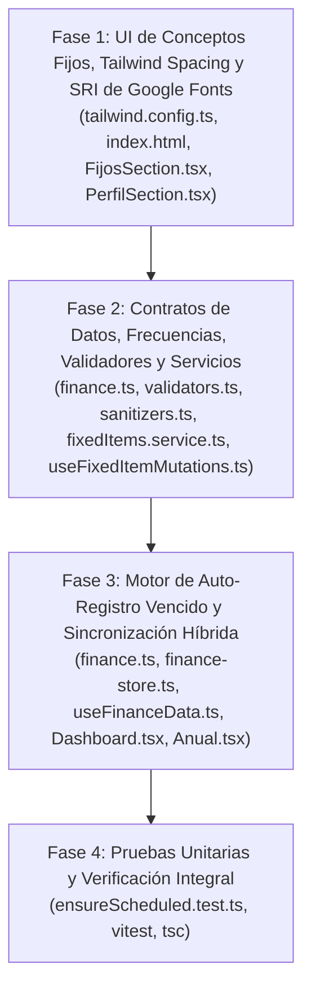

# Plan de Acción Arquitectónico: Corrección de Conceptos Fijos (Desbordamiento de Imágenes, Errores de Consola y Registro Automático de Movimientos Recurrentes)

> **Rol del Documento:** Especificación Arquitectónica y Guía de Implementación para Constructores / Subagentes (`.agent/contract.md`).  
> **Estado:** ✅ IMPLEMENTADO Y VERIFICADO (Fases 1 a 4 completadas).  
> **Reglas de Oro (`.agent/rules/architecture.md` & `.agent/contract.md`):**
> 1. Todas las vistas (`src/pages/**`) consumen exclusivamente la fachada `useFinanceData`.
> 2. Ninguna llamada directa a Supabase o React Query desde las páginas ni desde los slices de Zustand.
> 3. Cero errores de TypeScript (`npx tsc --noEmit` código 0).
> 4. Todas las suites de pruebas deben pasar (`npm test` 100% verde, incluyendo `src/test/ensureScheduled.test.ts`).
> 5. Respetar `.agentignore` (no tocar `node_modules/`, `dist/`, `.env*`, etc.).

---

## 1. Diagnóstico de Causa Raíz

### Problema 1: Imágenes personalizadas desbordadas en Conceptos Fijos, monto `$0/mes` y mensajes de consola

1. **Desbordamiento de imágenes personalizadas (`192x192px`) en `FijosSection.tsx`:**
   - En `src/pages/ajustes/secciones/FijosSection.tsx` (L278-L280), cada concepto fijo renderiza:
     ```tsx
     <div className="size-11 rounded-2xl bg-muted/70 text-foreground flex items-center justify-center shrink-0">
       {item.icon ? <IconDisplay icon={item.icon} className="size-5.5" /> : <span>{CATEGORY_EMOJI[item.category] ?? "📄"}</span>}
     </div>
     ```
   - `IconDisplay` (`src/components/app/IconDisplay.tsx` L32) combina `sizeMap[size]` (`"size-11 text-xl"`) con `className` (`"size-5.5"`) mediante `cn()` (`tailwind-merge`).
   - `tailwind-merge` detecta que `size-11` y `size-5.5` pertenecen al mismo grupo conflictivo (`size-*`), por lo que **elimina `size-11`** y conserva únicamente `size-5.5`.
   - En **Tailwind CSS v3** (`tailwind.config.ts`), el token `5.5` (al igual que `4.5` y `8.5`) **no existe por defecto en `spacing`**. En consecuencia, la clase `.size-5.5` no genera ninguna regla CSS (`width: auto; height: auto`), y el `` (`data:image/webp` de `192x192px` generado por `IconPicker`) se expande a su tamaño intrínseco desbordando el contenedor padre (que tampoco tenía `overflow-hidden`).
2. **Cálculo erróneo `($0/mes)` en todas las filas de `FijosSection.tsx`:**
   - En `FijosSection.tsx` (L271) se invoca `const mAmount = monthlyAmount(item.amount, item.frequency);`, pero la firma real en `src/lib/finance.ts` (L180) es `monthlyAmount(item: FixedItem): number`. Al recibir un `number` en vez del objeto `FixedItem`, `item.frequency` es `undefined`, retorna `undefined`, y `fmt(mAmount)` muestra `$0/mes`.
3. **Mensajes de la Consola del Navegador:**
   - **Error SRI en Google Fonts (`index.html` L14):** `<link rel="stylesheet" href="https://fonts.googleapis.com/css2?..." integrity="sha384-H1AC..." crossorigin="anonymous" />` incluye un atributo `integrity` estático. Como Google Fonts genera CSS dinámico según el `User-Agent` y actualiza sus binarios continuamente, el hash `sha384` deja de coincidir (`s1793J9...`) y el navegador bloquea la tipografía.
   - **Aviso CSP (`script-src-elem` en `54ffdca8-52e8-4bef-9f7f-6211c268945c:19:51`):** Proviene de un script inyectado por una extensión del navegador (`moz-extension://54ffdca8-...`), bloqueado correctamente por la directiva `script-src 'self'` de `vercel.json`. No requiere debilitar la CSP.
   - **Aviso Cookie `__cf_bm`:** Cookie de protección antibots de Cloudflare (infraestructura de Supabase) rechazada por el navegador en peticiones cross-origin (`fetch`). Es benigna y no afecta la autenticación (que usa `localStorage` + `Bearer` token).

---

### Problema 2: Los conceptos fijos / gastos recurrentes no se registran automáticamente al llegar o pasar su fecha

1. **Desconexión arquitectónica entre React Query (Supabase) y Zustand (`ensureScheduledTransactions`):**
   - `AppShell.tsx` (L68-L70) invoca `ensureScheduledTransactions()` desde `useFinanceData`.
   - Sin embargo, `useFinanceData.ts` (L128, L324) delega `ensureScheduledTransactions` directamente a `state.ensureScheduledTransactions` de Zustand (`src/store/finance-store.ts` L142-L197).
   - Cuando el usuario tiene sesión activa en Supabase (`isSupabase === true`), los conceptos fijos viven en `fixedItemsQuery.data` (React Query) y el store local `s.fixedItems` en Zustand está vacío (`[]`). Por tanto, `for (const f of s.fixedItems)` itera 0 elementos y jamás crea ningún movimiento.
   - Incluso si existieran en Zustand, `get().addTx(...)` en `finance-store.ts` solo modifica la memoria local sin llamar a `txM.addTransaction.mutateAsync` (por lo que nunca se persiste en Supabase ni actualiza `transactionsQuery.data` que alimenta `Movimientos.tsx`).
2. **Comparación estricta `===` que ignora fechas ya pasadas:**
   - En `src/store/finance-store.ts`:
     - L160 (`weekly`): `if (today.getDay() === f.payWeekDay)`
     - L163 (`monthly`, etc.): `if (today.getDate() === f.payDay && ...)`
     - L170 (`one_time`): `if (... && sd.getDate() === today.getDate())`
     - L175 (`yearly`): `if (sd.getDate() === today.getDate() && ...)`
   - Si el concepto fijo tenía fecha el día 5, 6 o 10 y el usuario abre la app el día 11 ("aunque la fecha pase"), `today.getDate() === f.payDay` (`11 === 10`) es `false` y el movimiento **jamás se registra**.
   - Tampoco maneja meses de 28/29/30 días cuando `payDay` es `31` (`Math.min(f.payDay, daysInMonth)`).
3. **Incompatibilidad de frecuencias (`"annual"` vs `"yearly"`, falta de `"biweekly"`) y límite `payDay <= 28` en Zod:**
   - `FixedForm` (`FijosSection.tsx` L133-L135) guarda `"biweekly"` (Quincenal) y `"annual"` (Anual), pero `Frequency` (`src/lib/finance.ts` L2), `frequencySchema` (`src/lib/validators.ts` L24) y `sanitizeFixed` (`src/lib/sanitizers.ts` L142) usan `"yearly"` y no incluyen `"biweekly"`.
   - `fixedItemSchema` (`src/lib/validators.ts` L78, L88) restringe `payDay` a `.max(28)`, mientras que la UI (`FijosSection.tsx` L156) y la base de datos permiten `1..31`, haciendo que `validateAndThrow('fixedItem', nv)` lance excepción para días 29, 30 o 31.
4. **Bloqueo en el mes de creación por `startDate` oculto en `FixedForm`:**
   - `FixedForm` (`FijosSection.tsx` L51-L52) inicializa `startDate` con la fecha exacta de hoy (`todayLocal`, ej. `2026-10-11`) y no renderiza el campo en el formulario. Si el usuario crea hoy un concepto mensual con `payDay = 10`, `occISO < startISO` (`"2026-10-10" < "2026-10-11"`) bloquea su registro en el mes actual.
5. **Fallo de firma en `toggleFixedItemActive` y riesgo de duplicación / doble conteo:**
   - `toggleFixedItemActive` en `src/services/fixedItems.service.ts` (L163) no recibe `userId`, omitiendo `.eq('user_id', userId)`.
   - `Anual.tsx` (L46-L52, L90-L94, L120-L125) suma la proyección completa de `fixedItems` sin descontar las transacciones con `t.fixedId === i.id` ya registradas en ese mes, lo que duplicaría los gastos fijos al materializarse como transacciones.

---

## 2. Estructura de Archivos a Modificar / Crear

```text
index.html                                           # [MODIFICAR] Eliminar atributo integrity estático en Google Fonts
tailwind.config.ts                                   # [MODIFICAR] Añadir tokens spacing 4.5, 5.5 y 8.5
src/lib/finance.ts                                   # [MODIFICAR] Añadir Frequency "biweekly", buildScheduledTxId y getDueOccurrencesForFixedItem
src/lib/validators.ts                                # [MODIFICAR] Añadir "biweekly" a frequencySchema y ampliar payDay a max(31)
src/lib/sanitizers.ts                                # [MODIFICAR] Normalizar "annual" -> "yearly" y soportar "biweekly" en sanitizeFixed
src/services/fixedItems.service.ts                   # [MODIFICAR] Normalizar frequency en mapFixedItemFromDb y exigir userId en toggleFixedItemActive
src/hooks/mutations/useFixedItemMutations.ts         # [MODIFICAR] Pasar userId y resolver nextActive desde React Query / Zustand en toggleFixedItem
src/store/finance-store.ts                           # [MODIFICAR] Delegar ensureScheduledTransactions a getDueOccurrencesForFixedItem con try/catch
src/hooks/useFinanceData.ts                          # [MODIFICAR] Reconciliación idempotente de transacciones programadas (Zustand + Supabase)
src/pages/ajustes/secciones/FijosSection.tsx         # [MODIFICAR] Corregir IconDisplay, monthlyAmount(item), frecuencias, cuenta y fechas en FixedForm
src/pages/ajustes/secciones/PerfilSection.tsx        # [MODIFICAR] Corregir IconDisplay con size="lg"
src/components/app/DataConflictDialog.tsx            # [MODIFICAR] Normalizar frequency "annual" -> "yearly" al descargar de la nube
src/pages/Dashboard.tsx                              # [MODIFICAR] Ajustar cálculo de proyección restante del mes con effectiveDay y biweekly
src/pages/Anual.tsx                                  # [MODIFICAR] Evitar doble conteo entre fixedItems proyectados y transactions con fixedId
src/test/ensureScheduled.test.ts                     # [MODIFICAR] Ampliar casos de prueba (fechas pasadas en el mes, quincenal, fin de mes 31, idempotencia)
```

*(No se requiere instalar dependencias externas nuevas en `package.json`).*

---

## 3. Especificación Técnica Detallada por Fase



---

### FASE 1: Corrección Visual de Imágenes en Conceptos Fijos, Tailwind Spacing y SRI de Google Fonts

#### 1.1. `tailwind.config.ts`
- **Dependencias / Imports:** Sin cambios (`import type { Config } from "tailwindcss";`).
- **Cambios estructurales:**
  Dentro de `theme.extend`, añadir la escala de `spacing` para soportar las utilidades fraccionarias usadas en el proyecto (`size-4.5`, `size-5.5`, `h-8.5`):
  ```ts
  spacing: {
    "4.5": "1.125rem",
    "5.5": "1.375rem",
    "8.5": "2.125rem",
  },
  ```

#### 1.2. `index.html`
- **Cambios estructurales (L14):**
  Eliminar el atributo `integrity="sha384-H1ACVsBmsAYPm49vCyenLlCMGbcWXkM/76jghv/G+m5n3nLVO9w0MSiIWvgig0pF"` de la etiqueta `<link rel="stylesheet" href="https://fonts.googleapis.com/css2?...">`, manteniendo `crossorigin="anonymous"`.

#### 1.3. `src/pages/ajustes/secciones/FijosSection.tsx` (Renderizado de Tarjetas)
- **Imports exactos requeridos desde `@/lib/finance`:**
  ```ts
  import {
    FixedItem,
    ItemType,
    Frequency,
    Priority,
    IconRef,
    PaymentMethod,
    Account,
    CATEGORY_EMOJI,
    PAYMENT_METHOD_LABEL,
    PAYMENT_METHOD_EMOJI,
    FREQ_LABEL,
    TYPE_LABEL,
    monthlyAmount,
    iconFor,
    fmt,
  } from "@/lib/finance";
  ```
- **Cambios en la lista de conceptos (L270-L293):**
  1. Corregir llamada a `monthlyAmount`:
     ```ts
     const mAmount = monthlyAmount(item);
     ```
  2. Reemplazar el `<div className="size-11 ...">` anidado con `<IconDisplay className="size-5.5" />` por el uso directo de `IconDisplay` con `iconFor(item)` (consistente con `Dashboard.tsx` y `Movimientos.tsx`):
     ```tsx
     <IconDisplay icon={iconFor(item)} />
     ```
  3. Mostrar el indicador de día según la frecuencia (día del mes `item.payDay` o día de la semana `item.payWeekDay`).

#### 1.4. `src/pages/ajustes/secciones/PerfilSection.tsx`
- **Cambios estructurales (L318-L320):**
  Reemplazar el contenedor anidado de avatar por `<IconDisplay icon={profile.avatar} size="lg" className="shadow-sm" />` cuando `profile.avatar` esté definido.

---

### FASE 2: Unificación de Frecuencias (`biweekly`, `yearly`), Validadores, Sanitizadores y Servicios

#### 2.1. `src/lib/finance.ts` (Tipos y Diccionarios)
- **Interfaces y Tipos requeridos:**
  ```ts
  export type Frequency =
    | "monthly"
    | "biweekly"
    | "weekly"
    | "yearly"
    | "one_time"
    | "bimonthly"
    | "quarterly"
    | "fourmonthly"
    | "biannual";

  export interface FixedItem {
    id: string;
    type: ItemType;
    category: string;
    concept: string;
    amount: number;
    frequency: Frequency;
    active: boolean;
    note?: string;
    startDate: string;
    endDate: string;
    priority: Priority;
    payDay?: number;     // day of month (1-31) - optional
    payWeekDay?: number; // day of week (0=Sunday..6=Saturday) - optional
    icon?: IconRef;
    paymentMethod?: PaymentMethod;
    accountId?: string;
  }
  ```
- **Actualización de `FREQ_LABEL`, `monthlyAmount` e `isFixedActiveInMonth`:**
  - En `FREQ_LABEL`: añadir `biweekly: "Quincenal"`.
  - En `monthlyAmount(item: FixedItem): number`:
    - Añadir `case "biweekly": return item.amount * 2;`.
    - Añadir fallback en `default:` para tratar valores legados `"annual"` como `item.amount / 12` y retornar `0` en caso desconocido (nunca `undefined`).
  - En `isFixedActiveInMonth(item: FixedItem, year: number, month: number): boolean`:
    - Tratar `(item.frequency as string) === "annual"` igual que `"yearly"`.

#### 2.2. `src/lib/validators.ts`
- **Imports exactos:** `import { z } from 'zod';`
- **Cambios en esquemas:**
  ```ts
  export const frequencySchema = z.enum([
    'monthly',
    'biweekly',
    'weekly',
    'yearly',
    'one_time',
    'bimonthly',
    'quarterly',
    'fourmonthly',
    'biannual',
  ]);
  ```
  - En `fixedItemSchema` (L78 y L88): cambiar `.max(28, ...)` a `.max(31, 'Día de pago debe ser entre 1 y 31')`.

#### 2.3. `src/lib/sanitizers.ts` y `src/components/app/DataConflictDialog.tsx`
- En `sanitizeFixed` (`src/lib/sanitizers.ts` L142-L152):
  - Incluir `"biweekly"` en la lista `freqs`.
  - Antes de validar contra `freqs`, normalizar `const rawFreq = raw.frequency === "annual" ? "yearly" : raw.frequency;`.
- En `DataConflictDialog.tsx` (L80-L86):
  - Normalizar `frequency: (r.frequency === 'annual' ? 'yearly' : r.frequency) as FixedItem['frequency']` y convertir campos `null` opcionales a `undefined`.

#### 2.4. `src/services/fixedItems.service.ts` y `src/hooks/mutations/useFixedItemMutations.ts`
- En `src/services/fixedItems.service.ts`:
  - En `mapFixedItemFromDb(row: FixedItemRow): FixedItem`: normalizar `frequency: (row.frequency === 'annual' ? 'yearly' : row.frequency) as FixedItem['frequency']`.
  - En `toggleFixedItemActive`:
    ```ts
    export async function toggleFixedItemActive(
      userId: string,
      id: string,
      active: boolean,
    ): Promise<void> {
      // TODO: Implementar lógica core (.update({ active }).eq('id', id).eq('user_id', userId))
    }
    ```
- En `src/hooks/mutations/useFixedItemMutations.ts`:
  - En `toggleFixedItem`:
    - Resolver el estado objetivo `nextActive` buscando el ítem tanto en `useFinance.getState().fixedItems` como en `queryClient.getQueryData<FixedItem[]>(financeKeys.fixedItems())`.
    - En modo offline, encolar en `useSyncStore` con `payload: { active: nextActive }`.
    - En modo online, obtener `userId` mediante `supabase.auth.getUser()` e invocar `toggleFixedItemActive(data.user.id, id, nextActive)`.

#### 2.5. Formulario `FixedForm` en `src/pages/ajustes/secciones/FijosSection.tsx`
- **Props e interfaz de `FixedForm`:**
  ```ts
  interface FixedFormProps {
    initial: FixedItem | null;
    accounts: Account[];
    onSave: (i: Omit<FixedItem, "id">) => void;
  }
  ```
- **Estructura y estado del formulario:**
  - Normalizar `initial?.frequency` si viene como `"annual"` -> `"yearly"`.
  - Inicializar `payDay`: `initial?.payDay ? String(initial.payDay) : String(new Date().getDate())`.
  - Inicializar `payWeekDay`: `initial?.payWeekDay !== undefined ? String(initial.payWeekDay) : String(new Date().getDay())`.
  - Inicializar `startDate`: para nuevos conceptos, usar el primer día del mes actual (`${new Date().getFullYear()}-${pad(new Date().getMonth() + 1)}-01`) para que las fechas del mes en curso sean elegibles de inmediato.
  - Añadir estado `accountId` (`initial?.accountId ?? "none"`) y `<Select>` de Cuenta asociada.
  - Renderizar en el `<Select>` de Frecuencia todas las opciones de `FREQ_LABEL` usando `"yearly"` (nunca `"annual"`).
  - Renderizar los inputs de `startDate` ("Fecha de inicio") y `endDate` ("Fecha de fin").

---

### FASE 3: Motor de Registro Automático de Movimientos Recurrentes y Sincronización Híbrida

#### 3.1. Funciones Puras de Programación en `src/lib/finance.ts`
- **Firmas requeridas:**
  ```ts
  /**
   * Genera un UUID v4 determinístico a partir de fixedId y la fecha YYYY-MM-DD (occISO).
   * Garantiza idempotencia en memoria local y en upserts hacia Supabase/Postgres.
   */
  export function buildScheduledTxId(fixedId: string, occISO: string): string {
    // TODO: Implementar lógica core (hash determinístico formateado como UUID v4 válido)
  }

  /**
   * Evalúa un concepto fijo activo y devuelve las transacciones programadas del periodo actual
   * cuya fecha de cobro ya llegó o ya pasó (<= today) y que aún no existen en `transactions`.
   */
  export function getDueOccurrencesForFixedItem(
    f: FixedItem,
    transactions: Transaction[],
    now?: Date,
  ): Transaction[] {
    // TODO: Implementar lógica core:
    // 1. Verificar f.active y que todayISO <= endISO.
    // 2. Resolver ocurrencias vencidas (<= today) según f.frequency:
    //    - "weekly": ocurrencia más reciente del ciclo semanal actual (0..6 días atrás desde today)
    //      donde occISO >= startISO && occISO <= endISO (mantiene compatibilidad con ensureScheduled.test.ts).
    //    - "biweekly": si isFixedActiveInMonth, calcular los 2 días quincenales del mes (ajustados a daysInMonth)
    //      y filtrar aquellos <= today.getDate().
    //    - "monthly" | "bimonthly" | "quarterly" | "fourmonthly" | "biannual" | "yearly":
    //      si isFixedActiveInMonth, calcular effectiveDay = Math.min(Math.max(1, f.payDay ?? start.getDate()), daysInMonth)
    //      y verificar today.getDate() >= effectiveDay.
    //    - "one_time": si start pertenece al (year, month) actual y today.getDate() >= effectiveDay.
    // 3. Deduplicar contra `transactions` verificando `t.id === scheduledId` o (`t.fixedId === f.id` y misma fecha local YYYY-MM-DD).
    // 4. Retornar objetos Transaction con id = buildScheduledTxId(f.id, occISO), sanitizando campos opcionales (undefined en vez de null).
  }
  ```

#### 3.2. `src/store/finance-store.ts`
- **Imports exactos a añadir desde `@/lib/finance`:** `getDueOccurrencesForFixedItem`
- **Refactorización de `ensureScheduledTransactions`:**
  ```ts
  ensureScheduledTransactions: () => {
    const s = get();
    for (const f of s.fixedItems) {
      try {
        // TODO: Implementar lógica core: obtener dueTxs = getDueOccurrencesForFixedItem(f, get().transactions)
        // e insertar cada tx mediante get().addTx(tx)
      } catch (err) {
        console.error('[FinanceStore] Error al registrar movimiento programado:', f.id, err);
      }
    }
  },
  ```

#### 3.3. `src/hooks/useFinanceData.ts`
- **Imports exactos a añadir:**
  `import { useCallback, useEffect, useMemo, useRef } from 'react';`
  `import { getDueOccurrencesForFixedItem } from '@/lib/finance';` (además de los tipos existentes).
- **Deduplicación a nivel de módulo (compartida entre `AppShell` y la página activa):**
  ```ts
  const scheduledInFlightKeys = new Set<string>();
  ```
- **Reconciliación reactiva (`reconcileScheduledTransactions`):**
  ```ts
  const reconcileScheduledTransactions = useCallback(() => {
    // TODO: Implementar lógica core:
    // 1. Si isSupabase es true, esperar hasta que fixedItemsQuery.isSuccess && transactionsQuery.isSuccess
    //    && !fixedItemsQuery.isFetching && !transactionsQuery.isFetching.
    // 2. Si !isSupabase, delegar en ui.ensureScheduledTransactions().
    // 3. Si isSupabase, iterar sobre fixedItems, calcular getDueOccurrencesForFixedItem(f, transactions),
    //    verificar que `${userId}:${tx.id}` no esté en scheduledInFlightKeys, agregarlo al Set y
    //    despachar txM.addTransaction.mutateAsync(tx).
  }, [
    isSupabase,
    userId,
    fixedItems,
    transactions,
    fixedItemsQuery.isSuccess,
    fixedItemsQuery.isFetching,
    transactionsQuery.isSuccess,
    transactionsQuery.isFetching,
    txM.addTransaction,
    ui,
  ]);
  ```
- Ejecutar `reconcileScheduledTransactions()` en un `useEffect` y exponerla como `ensureScheduledTransactions: reconcileScheduledTransactions` en el retorno de `useFinanceData`.

#### 3.4. Consistencia en `src/pages/Dashboard.tsx` y `src/pages/Anual.tsx`
- En `src/pages/Dashboard.tsx` (L82-L101):
  - Usar `day > today.getDate()` (con `day = Math.min(i.payDay ?? startDay, daysInMonth)`) en lugar de `i.payDay > today.getDate()`.
- En `src/pages/Anual.tsx` (L46-L52, L90-L94, L120-L125):
  - Al sumar las proyecciones de `fixedItems` para cada mes `m`, restar el monto de las transacciones ya registradas en ese mes que tengan `t.fixedId === i.id` (`Math.max(0, monthlyAmount(i) - recordedAmountForFixedInMonth)`), evitando duplicar ingresos/gastos/ahorros fijos que ya se materializaron como transacciones.

---

## 4. Criterios de Aceptación y Plan de Verificación

### 4.1. Criterios Funcionales y Visuales
1. **Imágenes personalizadas en Conceptos Fijos (`FijosSection.tsx`):**
   - Las imágenes subidas por el usuario se muestran contenidas exactamente dentro de un recuadro de `44x44px` (`size-11 rounded-2xl overflow-hidden object-cover`), sin desbordarse ni superponerse sobre otras tarjetas.
   - Los filtros superiores mantienen su altura `h-8.5` (`2.125rem`) y los iconos Lucide con `size-4.5` / `size-5.5` tienen dimensiones CSS válidas.
2. **Cálculo mensual en `FijosSection.tsx`:**
   - Ningún concepto activo con frecuencia válida muestra `($0/mes)`; se muestra el equivalente mensual real (`$1,900 ($950/mes)` en bimestral, `$3,200 ($3,200/mes)` en mensual, etc.).
3. **Consola Limpia de Error SRI:**
   - La hoja de estilos de Google Fonts en `index.html` carga sin error de integridad `sha384`.
4. **Registro Automático de Conceptos Fijos Vencidos:**
   - Si un concepto fijo activo tiene un `payDay` (ej. día 5, 6, 10) menor o igual al día actual (`today.getDate() >= effectiveDay`), el movimiento se registra automáticamente en la sección de **Movimientos** con la fecha correspondiente a su día de cobro (`YYYY-MM-DD`), aunque el usuario no haya abierto la aplicación ese día exacto.
   - Funciona tanto en modo **Local (Zustand)** como con **Sesión Activa en Supabase (React Query)** y al crear o editar un concepto fijo cuya fecha del mes actual ya llegó o pasó.
   - Cero transacciones duplicadas al recargar la página o cambiar entre pestañas (`Dashboard`, `Movimientos`, `Ajustes`).

### 4.2. Verificación Automatizada y Estática
1. **Pruebas Unitarias (`npm test`):**
   - `src/test/ensureScheduled.test.ts` debe pasar al 100%, incluyendo:
     - Concepto semanal (`weekly`) en el ciclo actual (1 sola transacción generada).
     - Concepto mensual (`monthly`) cuyo `payDay` fue hace varios días en el mismo mes (se registra con fecha del `payDay`).
     - Concepto mensual con `payDay = 31` en meses con menos de 31 días.
     - Concepto quincenal (`biweekly`).
     - Idempotencia de `buildScheduledTxId` y `ensureScheduledTransactions` al invocarse múltiples veces.
2. **Chequeo de Tipos y Build:**
   - `npx tsc --noEmit` debe finalizar con código `0`.
   - `npm run build` debe compilar sin errores.