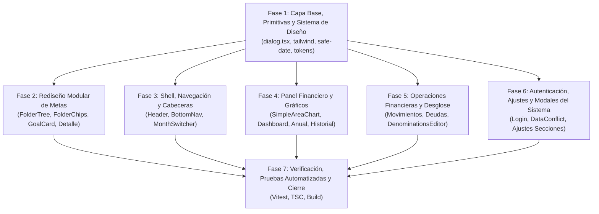

# Plan de Acción Arquitectónico: Rediseño de Metas y Auditoría Responsiva Integral de la App

> **Rol del Documento:** Especificación Arquitectónica y Guía de Implementación para Equipos de Desarrollo / Subagentes.  
> **Estado:** ✅ FASE DE IMPLEMENTACIÓN Y VERIFICACIÓN COMPLETADA (100% verde en tests y tsc).  
> **Reglas de Oro:**
> 1. Todas las vistas consumen exclusivamente la fachada `useFinanceData`.
> 2. Ninguna llamada directa a Supabase o React Query desde las páginas.
> 3. Cero errores de TypeScript (`npx tsc --noEmit` código 0).
> 4. Todas las suites de pruebas deben pasar (`npm test` 100% verde).
> 5. **No hacer push al repositorio remoto sin orden explícita del usuario**.

---

## 1. Decisiones de Diseño Confirmadas por el Usuario

1. **Acciones de Carpeta en Metas:** Migrar de los 3 botones inline actuales a un **menú contextual `...`** (`DropdownMenu`), liberando más de 70px para el nombre de las carpetas y subcarpetas.
2. **Carpetas en Móvil (<1024px):** Reemplazar el sidebar estático por una barra de **chips horizontales (`FolderChips`)** con botón para desplegar el árbol jerárquico completo en un **panel inferior (`Drawer`/`Sheet`)**.
3. **Alcance Responsivo:** Barrido completo de la aplicación (Metas, Dashboard, Anual, Historial, Movimientos, Deudas, Login, Ajustes y Diálogos globales).
4. **Estilo de Carpeta Activa:** Fondo suave con **barra de acento lateral de 3px** (`border-l-4 border-primary bg-primary/10`), eliminando el bloque cian sobresaturado.

---

## 2. Mapa de Fases de Ejecución



---

## 3. Especificación Detallada por Fases

### FASE 1: Capa Base, Primitivas de UI y Utilidades del Sistema
*Objetivo: Sentar los cimientos globales para que ningún diálogo o layout desborde en móviles de 320px–430px.*

#### 1.1. Diálogo Base (`src/components/ui/dialog.tsx`)
- **Problema actual (L39, L45):** `DialogContent` siempre inyecta un botón de cierre `X` propio (`DialogPrimitive.Close`) en `absolute right-4 top-4`. Cuando una vista (como Metas) añade su propio botón `X`, se generan **dos X superpuestas**. Además, no cuenta con límite de altura dinámica (`dvh`) ni margen en móviles, tocando los bordes de la pantalla.
- **Acciones técnicas:**
  - Agregar prop opcional a `DialogContent`: `hideCloseButton?: boolean`.
  - Condicionar el renderizado de `DialogPrimitive.Close`: solo si `!hideCloseButton`.
  - Cambiar el texto `sr-only` de `"Close"` a `"Cerrar"`.
  - Ampliar el área táctil del botón de cierre por defecto a mínimo 44px (`size-11 flex items-center justify-center`).
  - Añadir soporte para presentación como *bottom-sheet* en móvil:
    ```tsx
    className={cn(
      "fixed left-[50%] top-[50%] z-50 grid w-[calc(100%-1.5rem)] max-w-lg translate-x-[-50%] translate-y-[-50%] gap-4 border bg-background p-5 sm:p-6 shadow-lg duration-200 max-h-[calc(100dvh-2rem)] overflow-y-auto overscroll-contain sm:rounded-2xl",
      // Modo bottom-sheet automático en pantallas pequeñas
      "max-sm:top-auto max-sm:bottom-0 max-sm:left-0 max-sm:right-0 max-sm:translate-x-0 max-sm:translate-y-0 max-sm:w-full max-sm:max-w-full max-sm:rounded-b-none max-sm:rounded-t-3xl max-sm:max-h-[92dvh] max-sm:pb-[max(1.25rem,env(safe-area-inset-bottom))]",
      className
    )}
    ```

#### 1.2. Configuración Tailwind y Estilos Globales (`tailwind.config.ts` & `src/index.css`)
- **Problema actual:** No existe breakpoint para teléfonos pequeños (320px a 420px). Las clases que usan `h-screen` o `h-[90vh]` rompen el scroll cuando el teclado virtual o la barra de navegación del navegador móvil están visibles.
- **Acciones técnicas:**
  - En `tailwind.config.ts`, agregar a `screens`:
    - `xs: "420px"`
    - `2xs: "360px"`
  - En `src/index.css`:
    - Añadir regla utilitaria `.no-scrollbar` y soporte global para safe areas (`safe-bottom`, `safe-top`).
    - Añadir soporte de tipografía segura para números tabulares en moneda: `.tabular-nums`.

#### 1.3. Normalización y Blindaje de Fechas (`src/lib/finance.ts`)
- **Problema actual (`fmtDate`, L227):** `fmtDate(`${goal.deadline}T12:00:00`)` falla cuando `goal.deadline` ya viene en formato ISO completo (`"2026-05-10T00:00:00.000Z"`), concatenando `T12:00:00` y generando un `Invalid Date`. Al llamar `getDate()`, produce **`NaN/NaN/NaN`**.
- **Acciones técnicas:**
  - Blindar `fmtDate(d)`:
    ```typescript
    export function fmtDate(d: string | Date | null | undefined): string {
      if (!d) return "—";
      const dt = typeof d === "string" ? parseDateLocal(d) : d;
      if (isNaN(dt.getTime())) return "—";
      const dd = String(dt.getDate()).padStart(2, "0");
      const mm = String(dt.getMonth() + 1).padStart(2, "0");
      const yyyy = String(dt.getFullYear());
      return `${dd}/${mm}/${yyyy}`;
    }
    ```
  - Crear `parseGoalDeadline(deadline?: string): Date | null` que extraiga `deadline.slice(0, 10)` de forma segura antes de calcular días restantes o proyectar metas.

---

### FASE 2: Rediseño Modular de Metas (`src/pages/metas/`)
*Objetivo: Descomponer `Metas.tsx` (1,075 líneas), resolver la doble X, eliminar el truncamiento de carpetas y modernizar las tarjetas.*

#### 2.1. Estructura de Nuevos Archivos
```
src/pages/metas/
├── types.ts                    # Interfaces de FolderNode y vistas
├── FolderTree.tsx              # Árbol jerárquico de carpetas desktop
├── FolderTreeItem.tsx          # Fila de carpeta con menú contextual '...'
├── FolderChips.tsx             # Selector horizontal móvil con trigger de Drawer
├── GoalCompactCard.tsx         # Tarjeta de meta moderna, accesible y responsiva
├── GoalDetailContent.tsx       # Detalle de meta con soporte 92dvh y 1 sola X
├── GoalForm.tsx                # Formulario modal de creación/edición de metas
└── FolderForm.tsx              # Formulario modal de creación/edición de carpetas
```

#### 2.2. Componente `FolderTreeItem.tsx` (Solución a P2)
- Reemplazar los 3 botones inline (`FolderPlus`, `Pencil`, `Trash2`) por un único botón disparador de `DropdownMenu` (`size-8 rounded-lg hover:bg-muted` con icono `MoreHorizontal` o `MoreVertical`).
- Contenedor de la fila con `div` semántico (no `role="button"` con botones anidados). El clic para seleccionar se asigna a un botón transparente interno.
- Estilo activo: `border-l-4 border-primary bg-primary/10 text-primary font-bold`.
- El nombre de la carpeta ocupa todo el ancho disponible: `flex-1 min-w-0 font-medium text-sm text-foreground line-clamp-2 break-words text-left`.
- Sangría controlada: `paddingLeft: 8 + Math.min(level, 3) * 12` px, acompañada de una guía visual sutil `border-l border-border/50`.
- Chevron con orientación semántica correcta: `ChevronRight` que rota `90deg` al expandir.
- Opciones del menú contextual `DropdownMenu`:
  1. *Añadir subcarpeta* (icono `FolderPlus`).
  2. *Editar nombre e icono* (icono `Pencil`).
  3. *Eliminar carpeta* (icono `Trash2`, texto rojo, confirmación con `ElegantConfirm`).

#### 2.3. Componente `FolderChips.tsx` para Móviles
- En pantallas `< lg`, el sidebar vertical se oculta para no empujar las metas.
- Se renderiza una barra horizontal con scroll suave (`flex items-center gap-2 overflow-x-auto no-scrollbar -mx-4 px-4 py-1.5`).
- Chips rápidos para: *Todas*, *Sin carpeta* y carpetas principales.
- Botón al final con icono `FolderTree` rotulado "Todas las carpetas" que abre un `Drawer` inferior (`vaul`) conteniendo el árbol completo interactivo.

#### 2.4. Detalle de Meta (`GoalDetailContent.tsx` - Solución a P1 y P4)
- En `Metas.tsx`, el `DialogContent` del detalle llevará la prop `hideCloseButton={true}`.
- Se mantiene únicamente el botón de cierre estilizado integrado en el encabezado de la tarjeta:
  ```tsx
  <button
    type="button"
    onClick={() => setDetailId(null)}
    aria-label="Cerrar detalles"
    className="absolute top-4 right-4 size-11 rounded-full bg-black/30 hover:bg-black/50 text-white flex items-center justify-center backdrop-blur-md z-20 transition active:scale-95"
  >
    <X className="size-5" />
  </button>
  ```
- Fecha límite corregida usando `fmtDate(parseGoalDeadline(goal.deadline))`. Si no hay fecha, muestra `"Sin fecha límite"`.
- Los montos en el héroe de la tarjeta usan `text-3xl sm:text-4xl font-black tabular-nums break-words flex flex-wrap items-baseline justify-between gap-2`.

---

### FASE 3: Shell, Navegación y Cabeceras Globales

#### 3.1. `src/components/app/Header.tsx`
- **Problema (L18, L23):** En anchos de 320px–360px, cuando el título tiene subtítulo o hay 2 botones en la ranura `action` (como en Metas: *Carpeta* + *Nueva*), se produce colisión y desbordamiento.
- **Acción técnica:**
  - Título: `text-xl sm:text-2xl font-extrabold tracking-tight truncate text-balance min-w-0`.
  - Ranura `action`: envolver con `shrink-0 flex items-center gap-1.5 sm:gap-2`.
  - En los botones de acción secundarios (ej. "Carpeta"), ocultar el texto en móviles pequeños: `<span className="hidden xs:inline">Carpeta</span>`.

#### 3.2. `src/components/app/BottomNav.tsx`
- **Problema (L9, L24):** El padding inferior estático en algunos dispositivos no respeta la barra gestual de iOS/Android (`safe-bottom`). Las etiquetas de los 5 botones pueden colisionar en 320px si la fuente aumenta.
- **Acción técnica:**
  - Agregar `pb-[max(0.75rem,env(safe-area-inset-bottom))]` al contenedor fijo.
  - Asegurar `min-w-0 truncate` en la etiqueta de texto de cada ítem de navegación (`text-[10px] min-[360px]:text-micro font-semibold`).

#### 3.3. `src/components/app/MonthSwitcher.tsx`
- **Problema (L22, L36):** Botones con `size-8` (32px), por debajo de los 44px de accesibilidad. El diálogo modal no cuenta con márgenes de seguridad en teléfonos estrechos.
- **Acción técnica:**
  - Aumentar el contenedor a touch targets de mínimo 40px–44px: botones de anterior/siguiente con `size-9 min-[360px]:size-10`.
  - El modal de selección de periodo usará `DialogContent className="rounded-3xl w-[calc(100%-1.5rem)] max-w-xs p-5"`.

---

### FASE 4: Panel Financiero y Gráficos (Dashboard, Anual, Historial)

#### 4.1. Gráfico SVG Responsivo (`src/components/ui/SimpleAreaChart.tsx`)
- **Problema crítico (L42, L103, L148):**
  1. `w = Math.max(200, width || 600)`: en el primer ciclo de renderizado antes de que el `ResizeObserver` mida el DOM, `width` es 0 y el SVG se dibuja a **600px de ancho fijo**, provocando scroll horizontal involuntario en toda la pantalla.
  2. Solo escucha `onMouseMove`, ignorando eventos táctiles en smartphones.
  3. El tooltip no tiene delimitación y desborda hacia la derecha en móviles de 320px–390px.
- **Acciones técnicas:**
  - Iniciar ancho seguro: `const w = width || 300;`.
  - Añadir `viewBox={`0 0 ${w} ${h}`}` y `className="block w-full max-w-full h-auto overflow-hidden"`.
  - Añadir soporte táctil: enlazar `onPointerMove`, `onPointerDown` y `onPointerLeave`.
  - Delimitar tooltip: si `hoverIdx > n / 2`, posicionar anclado a la derecha (`right: w - x`) y añadir `max-w-[70vw] z-10 whitespace-nowrap shadow-md`.

#### 4.2. `src/pages/Dashboard.tsx`
- **Problema (L237, L262, L263):**
  - Saldo total con `text-4xl`: valores de más de 7 cifras se cortan en 320px.
  - MiniStats en `grid-cols-3 gap-2`: cada celda queda con menos de 55px útiles, truncando montos a `$12,3...`.
  - Botones de acción del header con `size-9` (36px).
- **Acciones técnicas:**
  - Héroe de saldo: `text-3xl min-[400px]:text-4xl tabular-nums truncate min-w-0`.
  - MiniStats: `grid grid-cols-1 min-[380px]:grid-cols-3 gap-2`.
  - Touch targets de botones del header: `size-11 flex items-center justify-center`.
  - Filas de transacciones recientes: aplicar `shrink-0 whitespace-nowrap tabular-nums` a los montos y `min-w-0 truncate` a los conceptos.

#### 4.3. `src/pages/Anual.tsx`
- **Problema (L177, L227, L248, L259):** Choque de escalas en gráficos combinados, MiniStats comprimidos y tabla mensual fija con `min-w-[400px]`.
- **Acciones técnicas:**
  - MiniStats anuales: `grid-cols-1 min-[420px]:grid-cols-3 gap-2`.
  - Resumen de deudas: tarjetas en `grid-cols-1 min-[400px]:grid-cols-3`.
  - Tabla anual: envolver en contenedor con scroll suave `overflow-x-auto no-scrollbar`, celda de mes `sticky left-0 bg-card z-10`.

#### 4.4. `src/pages/Historial.tsx`
- **Problema (L40, L43, L90):** `h-screen` oculta la parte inferior de la lista tras la barra de navegación del navegador móvil. Botón "Limpiar" colisiona en 320px.
- **Acciones técnicas:**
  - Cambiar `h-screen` por `min-h-[100dvh] pb-[calc(7rem+env(safe-area-inset-bottom))]`.
  - Botón "Limpiar": `<span className="hidden min-[360px]:inline">Limpiar</span>` con `aria-label="Limpiar historial"`.
  - Elementos de cambios auditados: cambiar `truncate` por `break-words line-clamp-2` para que el nuevo valor sea legible.

---

### FASE 5: Operaciones Financieras y Desglose (Movimientos, Deudas, Denominaciones)

#### 5.1. Editor de Desglose de Efectivo (`src/components/ui/DenominationsEditor.tsx`)
- **Problema crítico (L52–L60):** Cada fila mide más de 376px de ancho fijo (`Input w-28` + `Input w-20` + `select` + `botón`), desbordando por completo los modales en teléfonos de 320px–390px. La cabecera `grid-cols-12` no coincide con las filas inferiores.
- **Acciones técnicas:**
  - Reemplazar la fila por una estructura flex/grid responsiva:
    ```tsx
    <div className="grid grid-cols-[1fr_5rem_auto] min-[440px]:grid-cols-[7rem_5rem_1fr_auto] gap-2 items-center py-1.5 border-b border-border/50">
      <Input type="number" inputMode="decimal" placeholder="Valor" className="h-11 w-full min-w-0 text-sm" />
      <Input type="number" inputMode="numeric" placeholder="Cant." className="h-11 w-full min-w-0 text-sm" />
      <select className="h-11 w-full min-w-0 rounded-xl bg-muted px-2 text-xs">...</select>
      <button aria-label="Eliminar denominación" className="size-11 rounded-xl hover:bg-destructive/10 text-destructive flex items-center justify-center">
        <Trash2 className="size-4" />
      </button>
    </div>
    ```
  - Botón "Agregar denominación" y Total adaptados con `flex flex-wrap items-center justify-between gap-2`.

#### 5.2. `src/pages/Movimientos.tsx`
- **Problema (L197, L378, L469):** Filas de transacciones móviles acumulan: icono (40px) + título + monto + papelera (32px) + chevron (32px), dejando menos de 35px para el concepto en 320px. Formularios con `max-h-[90vh]` que se cortan con el teclado.
- **Acciones técnicas:**
  - Rediseñar la fila móvil:
    - Columna izquierda: Icono + Concepto (`min-w-0 truncate`) y categoría/cuenta.
    - Columna derecha: Monto destacado (`whitespace-nowrap tabular-nums text-sm font-bold`) + Chevron indicador.
    - La acción destructiva (eliminar) se reubica dentro del detalle expandido o menú contextual para no competir por ancho ni generar toques accidentales.
  - Formulario de movimientos: `max-h-[90dvh] overflow-y-auto` con botón "Guardar" pegajoso al fondo (`sticky bottom-0 bg-background pt-2 pb-1`).
  - Inputs con `text-base md:text-sm` para prevenir el zoom automático en iOS Safari.

#### 5.3. `src/pages/Deudas.tsx`
- **Problema (L72, L220):** SumCards en `grid-cols-3` cortan los números en 320px. Botones de editar y eliminar de cada deuda (`size-8`) están pegados sin separación (riesgo de eliminar por error).
- **Acciones técnicas:**
  - SumCards: `grid-cols-1 min-[380px]:grid-cols-3 gap-2`.
  - Botones de acción por deuda: touch targets `size-10` con separación física `gap-1.5`.
  - Diálogo de abono a deuda: `max-h-[90dvh] overflow-y-auto`.

---

### FASE 6: Autenticación, Ajustes y Modales del Sistema

#### 6.1. `src/pages/Login.tsx`
- **Problemas críticos:**
  1. Falta la importación de `toast` (`import { toast } from 'sonner'`), provocando `ReferenceError` si hay error de autenticación.
  2. `h-screen` y contenedor centrado sin scroll vertical: cuando el teclado virtual se abre en pantallas de 568px de alto, los campos de registro y botones OAuth quedan inaccesibles.
- **Acciones técnicas:**
  - Agregar `import { toast } from 'sonner';`.
  - Cambiar a `min-h-[100dvh] overflow-y-auto items-start sm:items-center py-6 px-4`.
  - Padding de la tarjeta: `p-5 min-[400px]:p-8`.
  - Todos los inputs de formulario con `text-base sm:text-sm` (evita zoom forzado en iOS Safari).

#### 6.2. Diálogo de Conflicto de Datos (`src/components/app/DataConflictDialog.tsx`)
- **Problema (L187, L220):** Diálogo de más de 640px de altura fija dentro de un contenedor no desplazable, bloqueando la pantalla en móviles pequeños. Botones con textos largos que se truncan.
- **Acciones técnicas:**
  - Contenedor con `overflow-y-auto max-h-[100dvh] sm:max-h-[90dvh]`.
  - Botones de selección de estrategia con `h-auto min-h-14 py-3 whitespace-normal text-left`.

#### 6.3. Módulo de Ajustes (`AjustesHub.tsx` & Secciones)
- **`AjustesHub.tsx`:** Títulos y badges adaptados con `flex-wrap gap-x-2 gap-y-0.5`. Descripciones con `line-clamp-2` en lugar de `truncate`.
- **`AjustesHeader.tsx`:** Botón "← Ajustes" con área táctil ampliada `h-11 min-w-11 px-3`.
- **`FijosSection.tsx` & `CuentasSection.tsx`:**
  - En anchos `<380px`, reestructurar las tarjetas en 2 filas: fila superior para icono + nombre; fila inferior para switches y botones de edición/eliminación (`size-10` o `size-11`). Esto evita que el título se reduzca a 60px.
- **`PerfilSection.tsx`:** Acción de "Desactivar 2FA" protegida con confirmación modal `ElegantConfirm` para evitar desactivaciones accidentales.

---

## 4. Distribución del Equipo de Subagentes

Para cuando se ordene la ejecución, el trabajo se dividirá entre **5 agentes especializados**:

| Agente | Especialidad | Responsabilidad y Archivos Asignados |
|---|---|---|
| **Agente 1** | *Core & Design System* | Modificar `dialog.tsx` (prop `hideCloseButton` y modo bottom-sheet), `tailwind.config.ts` (breakpoints `xs`, `2xs`), `index.css` y `src/lib/finance.ts` (`fmtDate` seguro y `parseGoalDeadline`). Ajustar `Header.tsx`, `BottomNav.tsx` y `MonthSwitcher.tsx`. |
| **Agente 2** | *Metas Specialist* | Descomponer `Metas.tsx` en `src/pages/metas/*` (`FolderTreeItem` con menú `...`, `FolderChips` móvil, `GoalCompactCard`, `GoalDetailContent` con 1 sola X y fecha segura). |
| **Agente 3** | *Analytics & Charts* | Modificar `SimpleAreaChart.tsx` (ancho inicial seguro, pointer events táctiles y tooltip delimitado), `Dashboard.tsx`, `Anual.tsx` e `Historial.tsx`. |
| **Agente 4** | *Operations & Cash* | Modificar `DenominationsEditor.tsx` (solucionar desborde de 376px), `Movimientos.tsx` (filas móviles optimizadas y formularios con `dvh`) y `Deudas.tsx`. |
| **Agente 5** | *Settings & Auth* | Agregar import de `toast` y scroll en `Login.tsx`, adaptar `DataConflictDialog.tsx`, y optimizar tarjetas en `AjustesHub.tsx`, `FijosSection.tsx`, `CuentasSection.tsx` y `PerfilSection.tsx`. |

---

## 5. Plan de Verificación y Criterios de Aceptación

### 5.1. Pruebas Automatizadas
1. **Prueba de Diálogos (`src/test/dialog-close.test.tsx`):**
   - Verificar que al pasar `hideCloseButton={true}` no se renderiza la X por defecto.
   - Verificar que los diálogos estándar conservan su botón de cierre accesible.
2. **Prueba de Metas y Carpetas (`src/test/metas-folders.test.tsx`):**
   - Verificar que nombres largos de carpeta no se cortan ni colisionan.
   - Verificar apertura y opciones del menú contextual `...`.
3. **Prueba de Fechas (`src/test/safe-date.test.ts`):**
   - Validar fechas ISO completas (`"2026-05-10T00:00:00.000Z"`), fechas cortas (`"2026-05-10"`), fechas vacías e inválidas. Cero `NaN/NaN/NaN`.
4. **Ejecución total:** `npm test` con **todas las suites en verde**.

### 5.2. Verificación Estática y Compilación
- `npx tsc --noEmit` debe retornar código de salida 0.
- `npm run build` debe generar el bundle de producción sin errores.

### 5.3. Matriz de Verificación Visual (Responsiva)
- **320px (iPhone SE 1ra Gen):** Cero scroll horizontal, cero textos encimados, diálogos completamente legibles.
- **360px (Android estándar):** Tarjetas de metas, transacciones y filtros alineados con márgenes consistentes.
- **390px (iPhone 12/13/14):** Experiencia táctil fluida con chips de carpetas y gráficos interactivos.
- **430px (iPhone Pro Max):** Uso armónico del espacio y grids fluidos.
- **768px (iPad/Tablet) & 1024px+ (Desktop):** Transición limpia entre chips móviles y sidebar lateral completo.