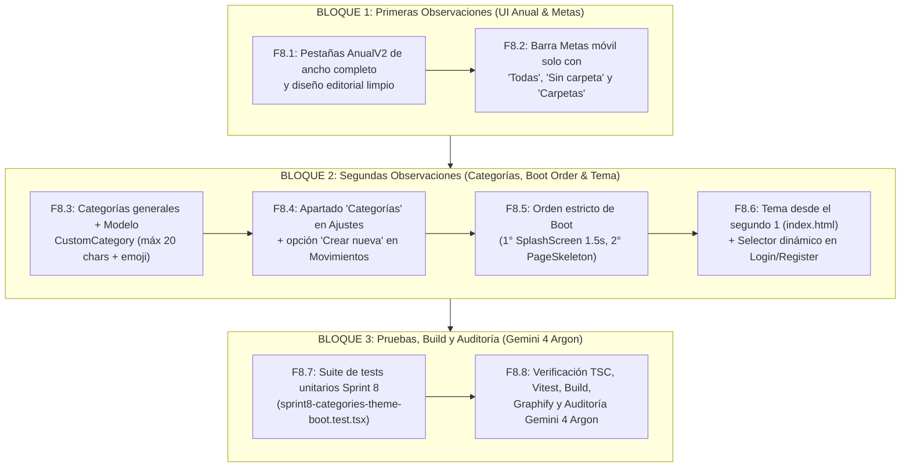

# 📐 Arquitectura & Plan Maestro: Pulido de Anual y Metas, Categorías Personalizadas, Orden de Boot y Tema Instantáneo (Sprint 8)

> **Fase:** 1 — Planificación y Orquestación Arquitectónica (Sprint 8)  
> **Agente Arquitecto & Auditor (Fases 1 y 3):** Antigravity CLI (`agy` — Google Gemini 4 Argon)  
> **Agente Constructor (Fase 2):** Antigravity CLI (`agy` — Google Gemini 3.8 Flash)  
> **Estado:** 🟢 PLAN ARQUITECTÓNICO COMPLETO — ESPERANDO APROBACIÓN DEL USUARIO  
> **Fecha:** 2026-10-25  
> **Rama Principal:** `redesign/ui-v2` (`pushRemote = no_push`)  

---

## 1. Resumen Ejecutivo del Sprint 8

Este **Sprint 8** se estructura en **2 grandes bloques funcionales** (más el bloque de verificación y auditoría) para resolver con precisión quirúrgica las observaciones visuales y de experiencia de usuario:

### Bloque 1 — Primeras Observaciones (Correcciones UI en Resumen Anual y Metas Móvil)
1. **Selector de Pestañas de Resumen Anual (`AnualV2.tsx` y `PillTabs.tsx`):**
   - Eliminar el contenedor estrecho alineado a la izquierda (`flex justify-start`) con fondo `bg-white/15` donde los botones `"General Categorias Metodos Metas"` se veían apretados, sin tildes y con mucho espacio vacío a la derecha.
   - Reemplazarlo por un control segmentado editorial de **ancho completo** (`w-full grid grid-cols-4`), con excelente aire interior (`px-3 py-2.5`), ortografía correcta (`General`, `Categorías`, `Métodos`, `Metas`) y una superficie activa elegante (`bg-white dark:bg-[#1C1C1A] border border-[#E4E0D8] dark:border-white/15 shadow-xs`).
2. **Barra Móvil de Carpetas en Metas (`FolderChips.tsx`):**
   - Eliminar la aparición de carpetas individuales (ej. `"Proyectos 2026 (1)"`) en la tira horizontal móvil que empujaba y tapaba el botón `"Carpetas"`.
   - Mostrar **únicamente** los 3 botones esenciales: **`"Todas"`**, **`"Sin carpeta"`** y **`"Carpetas"`** (que abre el explorador de carpetas en el drawer), garantizando que los 3 sean 100% visibles sin desbordamiento.

### Bloque 2 — Segundas Observaciones (Categorías Generales + Creación Personalizada, Orden de Arranque Splash → Skeletons, y Tema desde el Segundo 1 + Login/Register)
1. **Categorías Generales Universales + Creación de Categorías Personalizadas (Ajustes + Selector de Movimientos):**
   - Actualizar las categorías predeterminadas para que sean universales y cotidianas (*Alimentación*, *Transporte*, *Vivienda*, *Servicios*, *Salud*, *Educación*, *Entretenimiento*, *Compras*, *Familia y Mascotas*, *Trabajo / Sueldo*, *Negocio / Ventas*, *Ahorro e Inversión*, *Deudas y Préstamos*, *Regalos*, *Otros*), manteniendo retrocompatibilidad de iconos para movimientos históricos.
   - Soportar **Categorías Personalizadas (`CustomCategory`)** con **emoji** y **nombre de hasta 20 caracteres** (`maxLength={20}`) para que jamás se corte ni desborde.
   - Crear un **nuevo apartado `"Categorías"` en Ajustes** (`CategoriasSection.tsx`) y añadir la opción directa **`"+ Crear nueva"`** dentro del menú selector de categoría al registrar o editar un movimiento (`MovimientosV2.tsx`, `QuickTransactionSheet.tsx`, `FijosSection.tsx`).
2. **Orden Estricto de Arranque al Recargar (Primero Animación Splash, Después Skeletons):**
   - Elevar la compuerta de arranque (`SplashScreen` de 1.5s) por encima de `AuthGuard` y `Suspense` en `src/App.tsx` para que al recargar la página aparezca **primero la animación `SplashScreen` desde el milisegundo 0**, y **solo después** de terminar la animación se muestren los `PageSkeleton` si los datos aún siguen cargando.
3. **Detección de Tema desde el Segundo 1 (Cero Flash Claro) + Selector de Tema en Login y Register:**
   - Persistir de forma síncrona la preferencia de tema (`"light" | "dark" | "system"`) en `localStorage` (`"fp-theme-pref"`) e inyectar un `<script>` bloqueante ultraligero en el `<head>` de `index.html` que detecte el tema del dispositivo (`prefers-color-scheme: dark`) o el elegido por el usuario **antes del primer pintado**, eliminando por completo el destello claro inicial.
   - Incorporar un **Selector Dinámico de Tema (`Claro / Oscuro / Sistema`)** directamente en el panel de **Login y Register** (`LoginV2.tsx` y `LoginClassic.tsx`).

---

## 2. División de Roles y Modelos de IA

- **Arquitecto y Auditor (Fase 1 y Fase 3):** **Google Gemini 4 Argon** (`inherit` / `pro`). Diseña este plan arquitectónico, supervisa la integración y ejecuta la auditoría exhaustiva de código, tests y navegador.
- **Constructor Técnico (Fase 2):** **Google Gemini 3.8 Flash** (`flash`). Construye el código siguiendo cada bloque y tarea atómica especificada en `.agent/workflow/02_OPENCODE_TASKS.md` y `.agent/task.md`.

---

## 3. Razonamiento de Diseño Obligatorio (`frontend-ui-craft`)

1. **Intención UX y Punto Focal:**
   - **Resumen Anual y Metas (Bloque 1):** En los primeros 3 segundos, las 4 vistas de Resumen Anual (`General`, `Categorías`, `Métodos`, `Metas`) se perciben equilibradas, legibles y proporcionadas a todo el ancho; en Metas móvil, los 3 filtros (`Todas`, `Sin carpeta`, `Carpetas`) caben en una sola vista sin recortes, dejando la jerarquía profunda dentro del drawer progresivo.
   - **Categorías, Boot y Tema (Bloque 2):** Al recargar la app, el usuario experimenta su tema elegido o del sistema desde el milisegundo 0 con el `SplashScreen` editorial inmediato (sin parpadeos blancos ni skeletons prematuros), puede cambiar el tema desde Login/Register, y cuenta con categorías universales más creación instantánea de categorías propias (`emoji` + nombre de hasta 20 caracteres).
2. **Dirección Estética y Paleta a Medida (`--editorial` — Warm Editorial Wealth):**
   - **Canvas Background:** `#FAF8F5` (Warm Alabaster) en claro / `#0C0C0B` (Obsidian) en oscuro (aplicado desde `<head>` en `index.html`).
   - **Elevated Surface:** `#F2EFE9` (Oat) / `#141413` (Carbon) para rieles de pestañas, y `#FFFFFF` / `#1C1C1A` para el indicador activo.
   - **Primary Ink:** `#191918` (Espresso Charcoal) / `#EDEDED` (Soft Chalk).
   - **Muted Ink:** `#45423D` (Warm Stone AAA) / `#B0ADA7` (Muted Zinc AAA).
   - **Hairline Border:** `#E4E0D8` (1px) / `rgba(255,255,255,0.10)` (1px).
   - **Intentional Accent:** `#1F7A5A` (Editorial Emerald) y `#2383E2` (Precision Cobalt).
3. **Sistema Tipográfico:**
   - **Display / Cabeceras:** `'Fraunces'` (`font-display-v2`, `tracking-[-0.03em]`).
   - **UI Body & Controles:** `'Plus Jakarta Sans'` (`font-sans`, botones con `text-xs sm:text-sm font-semibold`).
   - **Métricas y Contadores:** `'JetBrains Mono'` (`font-mono-tabular`, `tabular-nums`, ej. contador `12/20` caracteres en categorías).
4. **Arquitectura Espacial e Interacción:**
   - **De-Boxing (Ley 1):** El selector de pestañas de Anual y la barra de 3 botones de Metas se integran armónicamente al ancho de la columna principal con divisores hairline de 1px.
   - **Micro-física Táctil:** Transiciones `transition-all duration-200 ease-[cubic-bezier(0.22,1,0.36,1)]` y respuesta táctil `active:scale-[0.98]`.

---

## 4. Arquitectura de Bloques de Ejecución



---

## 5. Especificación Técnica Detallada por Bloque

### BLOQUE 1 — Primeras Observaciones (Resumen Anual y Metas)

#### 5.1. Tarea F8.1: Rediseño del Selector de Pestañas en Resumen Anual
- **Archivos:**
  - [`src/components/anual/AnualV2.tsx`](file:///run/media/migol/Files/Projectos/Aplications/Finance%20Pal/Finance%20Pal%20APP/Finance%20Pal%20V1.19.38/finance-pal/src/components/anual/AnualV2.tsx)
  - [`src/components/app/PillTabs.tsx`](file:///run/media/migol/Files/Projectos/Aplications/Finance%20Pal/Finance%20Pal%20APP/Finance%20Pal%20V1.19.38/finance-pal/src/components/app/PillTabs.tsx)
- **Cambios Exactos:**
  1. En `AnualV2.tsx`, definir las pestañas con sus etiquetas bien escritas con tilde:
     ```ts
     const ANUAL_TABS: { key: Tab; label: string }[] = [
       { key: "general", label: "General" },
       { key: "categorias", label: "Categorías" },
       { key: "metodos", label: "Métodos" },
       { key: "metas", label: "Metas" },
     ];
     ```
  2. Reemplazar el `<div className="flex justify-start"><PillTabs ... /></div>` por un contenedor segmentado de ancho completo (`w-full grid grid-cols-4 gap-1.5 p-1.5 rounded-2xl bg-[#F2EFE9] dark:bg-[#141413] border border-[#E4E0D8] dark:border-white/10`):
     - Cada botón ocupa `1/4` del ancho disponible (`w-full min-h-[42px] px-2 sm:px-4 py-2 rounded-xl text-xs sm:text-sm font-semibold transition-all flex items-center justify-center text-center select-none active:scale-[0.98]`).
     - Estado activo: `bg-white dark:bg-[#1C1C1A] text-[#191918] dark:text-[#EDEDED] border border-[#E4E0D8] dark:border-white/15 shadow-xs font-bold`.
     - Estado inactivo: `text-[#6E6A63] dark:text-[#A09E97] hover:text-[#191918] dark:hover:text-[#EDEDED] hover:bg-white/50 dark:hover:bg-white/[0.03] border border-transparent`.
  3. Actualizar `PillTabs.tsx` para añadir `px-3.5 py-2 gap-1.5`, soporte opcional para `labels?: Record<T, string>`, y colores adaptados a superficies claras y oscuras (`bg-muted/70 border border-border/80`, inactivo `text-muted-foreground hover:text-foreground`).

#### 5.2. Tarea F8.2: Simplificación de la Barra de Carpetas en Metas Móvil
- **Archivo:**
  - [`src/pages/metas/FolderChips.tsx`](file:///run/media/migol/Files/Projectos/Aplications/Finance%20Pal/Finance%20Pal%20APP/Finance%20Pal%20V1.19.38/finance-pal/src/pages/metas/FolderChips.tsx)
- **Cambios Exactos:**
  1. Eliminar de la barra horizontal el mapeo de carpetas individuales (`folderTree.map(...)`) y el chip de `selectedSubfolder`.
  2. Renderizar **únicamente** los 3 botones en una fila limpia (`grid grid-cols-3 gap-2` o `flex items-center gap-2 w-full`):
     - **Botón 1:** `"Todas"` (`({goals.length})`) — activo cuando `selectedFolderId === null`.
     - **Botón 2:** `"Sin carpeta"` (`({uncategorizedCount})`) — activo cuando `selectedFolderId === "uncategorized"`.
     - **Botón 3:** `"Carpetas"` (abre el `Drawer` con `FolderTree`) — resaltado como activo cuando hay cualquier carpeta seleccionada (`selectedFolderId !== null && selectedFolderId !== "uncategorized"`), mostrando un indicador o contador sutil sin empujar ni tapar ningún botón.

---

### BLOQUE 2 — Segundas Observaciones (Categorías, Orden de Boot y Tema desde el Segundo 1)

#### 5.3. Tarea F8.3: Categorías Generales + Modelo `CustomCategory` (Máx. 20 Caracteres + Emoji)
- **Archivos:**
  - [`src/lib/finance.ts`](file:///run/media/migol/Files/Projectos/Aplications/Finance%20Pal/Finance%20Pal%20APP/Finance%20Pal%20V1.19.38/finance-pal/src/lib/finance.ts)
  - [`src/lib/sanitizers.ts`](file:///run/media/migol/Files/Projectos/Aplications/Finance%20Pal/Finance%20Pal%20APP/Finance%20Pal%20V1.19.38/finance-pal/src/lib/sanitizers.ts)
  - [`src/store/slices/settings-slice.ts`](file:///run/media/migol/Files/Projectos/Aplications/Finance%20Pal/Finance%20Pal%20APP/Finance%20Pal%20V1.19.38/finance-pal/src/store/slices/settings-slice.ts)
  - [`src/hooks/useFinanceData.ts`](file:///run/media/migol/Files/Projectos/Aplications/Finance%20Pal/Finance%20Pal%20APP/Finance%20Pal%20V1.19.38/finance-pal/src/hooks/useFinanceData.ts)
- **Cambios Exactos:**
  1. En `src/lib/finance.ts`:
     - Actualizar `CATEGORY_EMOJI` para que contenga categorías generales y universales para todo tipo de usuario:
       ```ts
       export const CATEGORY_EMOJI: Record<string, string> = {
         Alimentación: "🛒",
         Transporte: "🚗",
         Vivienda: "🏠",
         Servicios: "💡",
         Salud: "💊",
         Educación: "📚",
         Entretenimiento: "🎬",
         Compras: "🛍️",
         "Familia y Mascotas": "🐾",
         "Trabajo / Sueldo": "💼",
         "Negocio / Ventas": "📈",
         "Ahorro e Inversión": "🏦",
         Deudas: "🤝",
         Regalos: "🎁",
         Otros: "✨",
       };
       ```
     - Mantener `LEGACY_CATEGORY_EMOJI` para que transacciones históricas (`"Trabajo"`, `"Moto"`, `"Fondo"`, `"Conectividad"`, `"Apoyo familiar"`, `"Ocio"`, `"Cuidado personal"`, `"Hogar"`, `"Ropa"`, `"Café"`, `"Mascotas"`) conserven su icono en `emojiFor(cat)` sin aparecer como ruido personal en los selectores nuevos.
     - Definir:
       ```ts
       export const MAX_CUSTOM_CATEGORY_NAME_LENGTH = 20;

       export interface CustomCategory {
         id: string;
         name: string;
         emoji: string;
         createdAt?: string;
       }
       ```
     - Añadir `customCategories?: CustomCategory[]` en `AppSettings`.
     - Crear helper `getCategoriesMap(customCategories?: CustomCategory[]): Record<string, string>` que devuelva todas las categorías de `CATEGORY_EMOJI` más las `customCategories` del usuario.
     - Actualizar `emojiFor(cat: string, customCategories?: CustomCategory[])` para buscar en `customCategories`, luego en `CATEGORY_EMOJI` y luego en `LEGACY_CATEGORY_EMOJI`.
  2. En `src/store/slices/settings-slice.ts` y `src/hooks/useFinanceData.ts`:
     - Implementar y exponer:
       - `customCategories: CustomCategory[]`
       - `addCustomCategory: (input: { name: string; emoji: string }) => CustomCategory | null` (recorta `name.trim().slice(0, 20)`, verifica que no esté vacío y guarda en `appSettings.customCategories`).
       - `updateCustomCategory: (id: string, patch: { name?: string; emoji?: string }) => void`
       - `removeCustomCategory: (id: string) => void`

#### 5.4. Tarea F8.4: Nuevo Apartado `"Categorías"` en Ajustes + Opción Directa `"+ Crear nueva"` en Movimientos
- **Archivos:**
  - `[NEW]` `src/pages/ajustes/secciones/CategoriasSection.tsx`
  - `[NEW]` `src/components/app/CategorySelectWithCreate.tsx`
  - `[MODIFY]` `src/pages/ajustes/types.ts`, `src/pages/ajustes/AjustesV2.tsx`, `src/pages/Ajustes.tsx`, `src/pages/ajustes/AjustesHub.tsx`
  - `[MODIFY]` `src/components/movimientos/MovimientosV2.tsx`, `src/components/app/QuickTransactionSheet.tsx`, `src/pages/ajustes/secciones/FijosSection.tsx`
- **Cambios Exactos:**
  1. **`CategoriasSection.tsx` (Apartado en Ajustes):**
     - Permite ver las categorías generales del sistema y gestionar las **Categorías Personalizadas** del usuario.
     - Formulario de creación/edición con selector visual de emoji (grilla rápida de `COMMON_EMOJIS` + input libre de emoji) y campo de texto para el nombre con `maxLength={20}` y contador tabular `X/20 caracteres`.
     - Conectado en `AjustesV2.tsx` (y `Ajustes.tsx` / `AjustesHub.tsx`) bajo `seccion="categorias"` con badge dinámico (`"${customCategories.length} personalizadas"` o `"Generales"`).
  2. **`CategorySelectWithCreate.tsx` (Selector con creación directa en Movimientos):**
     - Componente selector de categoría que muestra todas las categorías disponibles (`getCategoriesMap(customCategories)`) y un ítem especial al final: **`➕ Crear nueva categoría...`**.
     - Al elegir **`➕ Crear nueva categoría...`**, abre un modal/popover compacto donde el usuario elige un emoji y escribe el nombre (`maxLength={20}`), y al pulsar **"Guardar"**, crea la categoría con `addCustomCategory` y la selecciona automáticamente en el formulario de movimiento actual.
     - Integrar este selector en `MovimientosV2.tsx` (tanto en `TransactionCreateForm` como en `TransactionEditForm` y en el filtro de categorías), en `QuickTransactionSheet.tsx` y en `FijosSection.tsx`.

#### 5.5. Tarea F8.5: Orden Estricto de Arranque (Primero Animación `SplashScreen`, Después `PageSkeleton`)
- **Archivos:**
  - [`src/App.tsx`](file:///run/media/migol/Files/Projectos/Aplications/Finance%20Pal/Finance%20Pal%20APP/Finance%20Pal%20V1.19.38/finance-pal/src/App.tsx)
  - [`src/components/app/AppShell.tsx`](file:///run/media/migol/Files/Projectos/Aplications/Finance%20Pal/Finance%20Pal%20APP/Finance%20Pal%20V1.19.38/finance-pal/src/components/app/AppShell.tsx)
- **Cambios Exactos:**
  1. Mover el control de `booting` (los 1500ms del `SplashScreen`) al nivel raíz en `src/App.tsx` (o sincronizarlo mediante un estado global de boot inicial en memoria) para que desde el **milisegundo 0** de la recarga de página se renderice `<SplashScreen />` cubriendo toda la pantalla (`z-[200]`).
  2. En `AuthGuard` y `AnimatedRoutes` (`src/App.tsx`):
     - Mientras `booting === true`, `<SplashScreen />` está activo en primer plano y **nunca** se muestra `<PageSkeleton />` antes que la animación.
     - Una vez que el temporizador de 1.5s concluye (`booting === false`), si `AuthGuard` (`loading` o `cloudHasData === null`) o el `<Suspense>` de la ruta aún sigue cargando, **ahora sí** se muestra `<PageSkeleton />`.
  3. Eliminar el estado duplicado de `SplashScreen` en `AppShell.tsx` (o compartir el mismo estado de boot de sesión) para que el splash no se ejecute dos veces.

#### 5.6. Tarea F8.6: Tema desde el Segundo 1 (Cero Flash Claro) + Selector Dinámico en Login y Register
- **Archivos:**
  - `[NEW]` `src/lib/theme-sync.ts`
  - `[MODIFY]` `index.html`
  - `[MODIFY]` `src/store/slices/settings-slice.ts` y `src/store/finance-store.ts`
  - `[MODIFY]` `src/pages/LoginV2.tsx` y `src/pages/LoginClassic.tsx`
- **Cambios Exactos:**
  1. **Persistencia Síncrona Instantánea (`src/lib/theme-sync.ts`):**
     - Crear utilidades `readInitialThemePref()` y `writeThemePref({ theme, uiVersion, accentColor, highContrast })` que leen/escriben en `localStorage.getItem("fp-theme-pref")` y aplican de inmediato las clases `.dark`, `.ui-v2` / `.ui-classic` y el color de fondo del `document.documentElement`.
     - En `settings-slice.ts`, inicializar `theme` con `readInitialThemePref().theme` (en vez de esperar a que termine la desencriptación asíncrona de IndexedDB/WebCrypto) y llamar a `writeThemePref` en `setTheme`, `toggleTheme`, `setUIVersion`, `setAccentColor` y en el `merge` de `finance-store.ts`.
  2. **Script Bloqueante en `<head>` de `index.html`:**
     - Añadir un `<script>` inline síncrono en `index.html` antes de `</head>` que lee `"fp-theme-pref"` de `localStorage`, detecta `window.matchMedia("(prefers-color-scheme: dark)").matches` cuando el modo es `"system"` (o cuando el usuario entra por primera vez), aplica la clase `dark` y `ui-v2` en `<html>`, y establece el `background-color` (`#0C0C0B` en oscuro, `#FAF8F5` en claro) desde el **segundo 0**, evitando cualquier destello de tema claro.
  3. **Selector Dinámico de Tema en Login y Register (`LoginV2.tsx` y `LoginClassic.tsx`):**
     - Añadir en la esquina superior derecha / barra superior de `LoginV2.tsx` y `LoginClassic.tsx` un control segmentado interactivo (`Claro` ☀️ / `Oscuro` 🌙 / `Sistema` 💻) conectado a `useFinance((s) => s.setTheme)` y `useSystemTheme()`.
     - Disponible tanto al **Iniciar Sesión**, como al **Registrarse (Crear Cuenta)** y en **Verificación 2FA**, cambiando el tema en tiempo real sin recargar.
