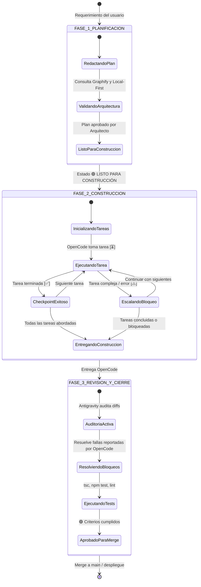

# 📜 Protocolo Operativo Multi-Agente: Antigravity ↔ OpenCode

> **Proyecto:** Finance Pal v1.21.0+  
> **Ubicación:** `.agent/workflow/protocol.md`  
> **Ámbito:** Colaboración orquestada entre Arquitecto (`antigravity-cli`) y Constructor (`opencode-cli`).

---

## 1. Declaración de Agentes y Modelos Autorizados

Este flujo de trabajo define una jerarquía estricta de dos agentes con modelos de inteligencia artificial especializados:

```
┌────────────────────────────────────────────────────────┐
│                   ANTIGRAVITY CLI                      │
│       Modelos Exclusivos: Gemini 3.8 Flash / Argon 4   │
│   Roles: Arquitecto Principal, Orquestador y Revisor   │
└───────────────────────────┬────────────────────────────┘
                            │
               1. Plan Maestro (01_ARCHITECT_PLAN.md)
                            │
                            ▼
┌────────────────────────────────────────────────────────┐
│                    OPENCODE CLI                        │
│          Modelo Exclusivo: DeepSeek 4.1 Flash          │
│         Rol: Constructor / Implementador Técnico        │
└───────────────────────────┬────────────────────────────┘
                            │
            2. Checkpoints + Escalación (02_OPENCODE_TASKS.md)
                            │
                            ▼
┌────────────────────────────────────────────────────────┐
│                   ANTIGRAVITY CLI                      │
│       Modelos Exclusivos: Gemini 3.8 Flash / Argon 4   │
│       Roles: Auditor, Solución de Bloqueos y Merge     │
│             (03_ANTIGRAVITY_REVIEW.md)                 │
└────────────────────────────────────────────────────────┘
```

| Agente | CLI / Entorno | Modelos Obligatorios | Responsabilidad Principal |
| :--- | :--- | :--- | :--- |
| **Arquitecto / Líder** | `antigravity-cli` (o sesión Antigravity) | **Google Gemini 3.8 Flash**<br>**Google Argon 4** | Planificación, diseño de tipos, definición de contratos, revisión de código, resolución de bloqueos y cierre. |
| **Constructor** | `opencode-cli` | **DeepSeek 4.1 Flash** | Implementación de código base, componentes, servicios, ejecución de pruebas y registro de checkpoints. |

---

## 2. Máquina de Estados del Ciclo de Vida

El desarrollo de cualquier característica o corrección atraviesa 4 estados inmutables:



---

## 3. Especificación de Fases y Archivos de Registro

### Fase 1: Planificación Arquitectónica
- **Responsable:** Antigravity (Google Gemini 3.8 Flash / Argon 4).
- **Archivo Activo:** `.agent/workflow/01_ARCHITECT_PLAN.md` (Plantilla: `templates/01_ARCHITECT_PLAN.template.md`).
- **Regla de Oro:** En esta fase, Antigravity **no escribe código de implementación**. Especifica la arquitectura:
  1. Alineación con Local-First y fachada `useFinanceData`.
  2. Interfaces y tipos de TypeScript exactos.
  3. Lista secuencial y numerada de tareas para OpenCode.
  4. Criterios de aceptación comprobables (`npm test`, build limpio).
- **Criterio de Salida:** Marcar el encabezado con `> **Estado:** 🟢 LISTO PARA CONSTRUCCIÓN`.

---

### Fase 2: Construcción y Checkpoints
- **Responsable:** OpenCode CLI (DeepSeek 4.1 Flash).
- **Archivo Activo:** `.agent/workflow/02_OPENCODE_TASKS.md` (Plantilla: `templates/02_OPENCODE_TASKS.template.md`).
- **Directivas:**
  1. Copia la lista de tareas del plan.
  2. Gestiona el estado de tareas:
     - `[ ]` Pendiente
     - `[⏳]` En progreso (solo una a la vez)
     - `[✅]` Completada (tras verificar build local)
     - `[⚠️]` Bloqueada / Fallida
  3. **Protocolo de Fallos y Bloqueos (Mandatorio):**
     - Si una tarea presenta un error irresoluble o lógica que excede las capacidades del modelo DeepSeek 4.1 Flash:
       - No insistir en bucles fallidos.
       - Marcar la tarea con `[⚠️]`.
       - Registrar el incidente en la **Sección 3: Escalation Log** detallando archivo, error exacto y qué necesita de Antigravity.
       - Dejar un stub en código: `// TODO: [ESCALATED TO ANTIGRAVITY] <detalle>`.
  4. **Checkpoints:** Realizar commits atómicos por tarea o grupo coherente y registrar el hash.
- **Criterio de Salida:** Marcar `> **Estado General:** 🟢 COMPLETADO` o `⚠️ COMPLETADO CON BLOQUEOS / PENDIENTES`.

---

### Fase 3: Revisión, Auditoría y Finalización
- **Responsable:** Antigravity (Google Gemini 3.8 Flash / Argon 4).
- **Archivo Activo:** `.agent/workflow/03_ANTIGRAVITY_REVIEW.md` (Plantilla: `templates/03_ANTIGRAVITY_REVIEW.template.md`).
- **Directivas Obligatorias:**
  1. **Llevar el triple registro dinámico:**
     - 🔍 **Cosas que está revisando actualmente (In Progress)**: Módulo bajo inspección activa.
     - ✅ **Cosas que ya revisó (Audited & Closed)**: Veredicto (`🟢 APROBADO` o `🛠️ CORREGIDO`) y notas.
     - ⏳ **Cosas que va a revisar (Backlog)**: Elementos pendientes por auditar.
  2. **Intervención Activa y Resolución de Bloqueos:**
     - Antigravity examina el **Escalation Log** de OpenCode.
     - Antigravity implementa directamente las partes pendientes o complejas utilizando la capacidad de razonamiento de Argon 4 / Gemini 3.8 Flash.
     - Registra cada corrección en la **Sección 5: Tareas y Lógica Completadas por Antigravity**.
  3. **Validación Final:**
     - `npx tsc --noEmit`
     - `npm test`
     - Verificación de no-fuga de datos ni secretos en `.agentignore`.
- **Criterio de Salida:** Emitir `[🟢 APROBADO PARA MERGE]` y firmar la revisión.

---

## 4. Estrategia de Git Worktree (Aislamiento de Entorno)

Para evitar interferencias en archivos no confirmados y permitir compilaciones independientes, se utiliza Git Worktree:

### Esquema de Directorios:
```
[ finance-pal/ ]                         <-- Worktree Principal (Rama main o feature)
  ├── .agent/workflow/                   <-- Documentos compartidos
  ├── src/
  └── .worktrees/
        └── builder/                     <-- Worktree Secundario (Rama builder/<feature>)
              └── [ finance-pal copia ]  <-- Espacio exclusivo de OpenCode CLI
```

### Comandos de Gestión:
- **Crear worktree de construcción:**
  ```bash
  ./.agent/workflow/scripts/worktree-manager.sh create mi-feature
  ```
- **Monitorear estado del worktree y de los agentes:**
  ```bash
  ./.agent/workflow/scripts/worktree-manager.sh status
  ./.agent/workflow/scripts/handoff.sh status
  ```
- **Obtener prompt para el siguiente agente:**
  ```bash
  ./.agent/workflow/scripts/handoff.sh next
  ./.agent/workflow/scripts/handoff.sh prompt 2   # Para OpenCode
  ./.agent/workflow/scripts/handoff.sh prompt 3   # Para Antigravity Reviewer
  ```
- **Eliminar worktree tras finalizar la tarea:**
  ```bash
  ./.agent/workflow/scripts/worktree-manager.sh remove
  ```

---

## 5. Reglas Invariables de Seguridad y Arquitectura

1. **Local-First Estricto:** Toda interacción de interfaz con los datos financieros debe pasar por `useFinanceData`. Ningún componente debe invocar directamente servicios de Supabase.
2. **Protección de Secretos:** Respeta `.agentignore`. Ningún agente puede leer, escribir o incluir en commits archivos `.env*` ni credenciales reales.
3. **Graphify Protocol:** Antes de realizar búsquedas extensas en el código, los agentes deben apoyarse en el grafo de conocimiento (`graphify query "<concepto>"`).
